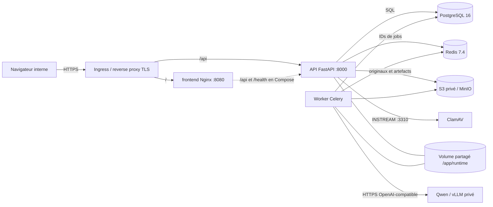

# Guide de déploiement — Atelier documentaire privé

Ce guide décrit, étape par étape, comment installer, vérifier, exploiter et mettre à jour la plateforme (frontend Angular, API FastAPI, worker Celery, PostgreSQL, Redis, stockage S3, antivirus ClamAV et passerelle d’IA privée). Il complète `docs/installation.md`, `docs/operations.md`, `docs/release.md`, `docs/private-ai.md` et `infrastructure/README.md` : en cas de divergence, **le code fait foi**, et ce guide signale explicitement les écarts constatés entre le code et les manifestes.

| Élément | Valeur |
| --- | --- |
| Code de référence | branche `feature/run28-moteur-simplification-20261014`, commit `a4a86eb` (code testé RUN28) |
| Date de rédaction | 16/10/2026 |
| Statut qualité du moteur | 8/8 documents du corpus en `REVIEW_REQUIRED` ; score officiel v2 65,7 (seuil 94 non atteint) ; 0/1 072 lignes de validation humaine réalisées |
| Statut IA privée | Qwen/vLLM **non qualifié** : aucun endpoint, tokenizer ni poids réel n’a été exécuté |

> **Avertissement.** Ce guide permet d’installer la plateforme, mais il **n’autorise pas une mise en production bancaire**. La promotion en production exige : la levée des écarts du chart Helm (§ 7), un endpoint Qwen privé qualifié, une attestation privée acceptée par `tools/release_gate.py` et une validation humaine. Tant que ces conditions ne sont pas remplies, l’usage est limité au laboratoire et à la pré-production sur données synthétiques ou autorisées.

## Niveaux de preuve utilisés dans ce guide

Chaque procédure porte l’un des marqueurs suivants. Aucune étape non exécutée n’est présentée comme validée.

| Marqueur | Signification |
| --- | --- |
| **[V-SANDBOX]** | Exécuté de bout en bout le 16/10/2026 sur le commit `a4a86eb`, dans un projet Compose isolé avec des secrets aléatoires et un PDF synthétique (résultats au § 13). |
| **[V-CI]** | Exécuté par la CI GitHub sur `a4a86eb` (run `38596895140`, succès) : tests backend, intégration PostgreSQL + Alembic, frontend, `docker compose config`, `helm lint`, `helm template` et construction des images. |
| **[STATIQUE]** | Déduit de la lecture du code et du rendu `helm template`, sans cluster. |
| **[NON TESTÉ]** | Aucune exécution disponible ; à valider par l’opérateur. |

## 1. Architecture de déploiement



| Composant | Image / source | Port | Utilisateur | Rôle |
| --- | --- | --- | --- | --- |
| frontend | `frontend/Dockerfile` (Node 22 → `nginxinc/nginx-unprivileged:1.27-alpine`) | 8080 | 101 | Fichiers Angular statiques, proxy `/api` en Compose, sonde `/healthz`. Les en-têtes de sécurité (CSP, HSTS, X-Frame-Options, nosniff, Referrer-Policy, Permissions-Policy) sont déclarés, mais **ne sont effectivement servis que sur `/healthz`** (écart G11). |
| api | `backend/Dockerfile` (`python:3.12-slim-bookworm`) | 8000 | 10001 | API REST sous `/api` (dont `/api/health`, qui vérifie les dépendances), `/health` (vivacité statique), `/metrics`, validation des dépôts, antivirus, mise en file des jobs. |
| worker | même image que l’API, commande `celery` | — | 10001 | Analyse, OCR Tesseract, traduction, reconstruction, conversions LibreOffice (DOCX/XLSX/PPTX). File `documents`, concurrence 2, prefetch 1. |
| PostgreSQL | `postgres:16-bookworm` (Compose) ou service externe | 5432 | — | Métadonnées, audit, utilisateurs, tenants. Schéma géré par Alembic (`0001_baseline`, `0002_industrial`). |
| Redis | `redis:7.4-alpine` (Compose) ou service externe | 6379 | — | Broker et backend de résultats Celery (identifiants uniquement). |
| S3 | MinIO construit depuis une source épinglée (Compose) ou S3 privé avec KMS | 9000 | 10001 | Originaux immuables et artefacts (préfixe `documents`). |
| ClamAV | `clamav/clamav:1.4.3` (profil Compose `antivirus`) ou service privé | 3310 | — | Analyse INSTREAM des dépôts, sans fichier temporaire. |
| IA privée | endpoint OpenAI-compatible privé (vLLM/Qwen) | 8000 (chart) | — | Traduction. Budget dur de 32 768 jetons (entrée ≤ 22 000, sortie ≤ 8 000, marge 2 768). |

L’image backend contient Tesseract (ara, deu, eng, fra, ita, nld, spa), les polices DejaVu et LibreOffice Writer/Calc/Impress. Les variables `HF_HUB_OFFLINE=1` et `TRANSFORMERS_OFFLINE=1` y sont fixées : aucun poids n’est téléchargé à l’exécution.

Formats acceptés au dépôt (`backend/app/infrastructure/validation.py`) : PDF, DOCX, XLSX, PPTX, PNG, JPG/JPEG, TIF/TIFF, dans la limite de 25 Mio et de 200 pages par défaut. Les fichiers Office contenant des macros, des contrôles ActiveX, des connexions ou liens externes ou des objets incorporés sont refusés.

## 2. Choisir le mode de déploiement

| Mode | Usage autorisé | Moteur | Outil | État |
| --- | --- | --- | --- | --- |
| Laboratoire | Développement, démonstration, tests sur données synthétiques | `offline` (par défaut) | Docker Compose (§ 5) | **[V-SANDBOX]** |
| Pré-production | Recette technique d’infrastructure, sur données synthétiques ou explicitement autorisées | `private` | Helm sur Kubernetes (§ 6) | **[STATIQUE]** : écarts bloquants à corriger (§ 7) |
| Production | Documents réels | `private` uniquement | Helm + release gate + validation humaine (§ 8) | **Bloquée** à ce jour |

Le moteur `interim` est un fournisseur **temporaire**, réservé aux fixtures synthétiques ou aux documents couverts par une autorisation privée du propriétaire. Il est refusé par configuration quand `TRANSLATOR_ENVIRONMENT=private`, et le profil production impose `TRANSLATOR_ENGINE=private`. Il ne doit jamais être configuré en pré-production ni en production.

## 3. Prérequis

### 3.1 Matériel (valeurs configurées, non mesurées en charge)

| Service | Compose (limites) | Helm (requêtes → limites) |
| --- | --- | --- |
| api | 2 vCPU, 2 Gio (`API_CPUS`, `API_MEMORY_LIMIT`) | 250 m / 512 Mio → 2 vCPU / 2 Gio, 2 réplicas |
| worker | 2 vCPU, 4 Gio (`WORKER_CPUS`, `WORKER_MEMORY_LIMIT`) | 250 m / 512 Mio → 2 vCPU / 4 Gio, 1 réplica |
| frontend | 1 vCPU, 512 Mio | 100 m / 128 Mio → 1 vCPU / 512 Mio, 2 réplicas |
| volume partagé | volume nommé `runtime-data` | PVC RWX 50 Gio (`scratch.size`) |
| IA privée | hors Compose | 1 GPU par défaut (`model.gpuCount`), **dimensionnement non mesuré** |

La capacité à 100 utilisateurs ou 200 pages n’est pas démontrée. `tools/load_test.py` ne mesure qu’une campagne synthétique bornée, et les mesures OCR/LLM/GPU restent `null` tant que l’instrumentation ne les fournit pas.

### 3.2 Logiciels

- **Laboratoire** : Docker Engine et Docker Compose v2. La validation a été faite avec Docker 29.1.3 et Compose 2.40.3. La construction des images exige un accès sortant aux dépôts Debian, PyPI, npm, aux modules Go et à GitHub (pour les sources MinIO/mc épinglées par commit).
- **Kubernetes** : Helm 3 (lint validé en v3.16.4 localement et v3.17.3 en CI), un CNI qui applique les NetworkPolicy, une StorageClass RWX (`private-rwx` par défaut), un contrôleur ingress-nginx (les annotations du chart lui sont propres), un registre d’images privé et un TLS géré par l’opérateur.
- **IA privée** : un endpoint HTTPS OpenAI-compatible (`/chat/completions`) et un tokenizer local lisible par le worker (`TRANSLATOR_TOKENIZER_PATH`). Aucun nom de modèle Qwen exact n’est imposé par le dépôt.
- **Sauvegardes** : `pg_dump`/`pg_restore` et l’accès S3 depuis la machine qui exécute `tools/ops_backup.py` et `tools/ops_restore.py`.

### 3.3 Réseau

À l’exécution, aucun flux sortant vers Internet n’est nécessaire. Les seuls flux attendus sont : navigateur → Ingress (HTTPS) ; Ingress → frontend et API ; API/worker → PostgreSQL, Redis, S3, ClamAV et IA privée. La passerelle IA refuse toute adresse résolue publique, re-résout le DNS avant chaque requête, ignore les variables proxy (`trust_env=False`) et ne suit aucune redirection.

## 4. Référence de configuration

Toutes les variables applicatives portent le préfixe `TRANSLATOR_` (`backend/app/core/settings.py`). Un fichier `.env` local est lu s’il est présent, mais il ne doit **jamais** être commité : seul `.env.example` est versionné. La colonne « Production » liste les exigences vérifiées au démarrage par `Settings` (exception de configuration) ou par `infrastructure/docker/production-entrypoint.sh` (sortie 78).

### 4.1 Général, base de données et authentification

| Variable | Défaut du code | Production | Remarques |
| --- | --- | --- | --- |
| `TRANSLATOR_ENVIRONMENT` | `local` | `production` (ou `prod`) | Active les gardes fail-closed. Le chart Helm ne l’injecte pas (§ 7, écart G5). |
| `TRANSLATOR_DATABASE_URL` | SQLite local | `postgresql+psycopg://…` | PostgreSQL obligatoire en production. |
| `TRANSLATOR_AUTO_CREATE_SCHEMA` | `true` | `false` | À `false`, l’API et le worker refusent de démarrer si la révision Alembic n’est pas à jour (`DATABASE_MIGRATION_REQUIRED`). |
| `TRANSLATOR_JWT_SECRET` | aucun | ≥ 64 caractères | ≥ 32 caractères dans tous les cas. Sa rotation invalide les sessions. |
| `TRANSLATOR_JWT_EXPIRE_MINUTES` | `60` | — | Entre 1 et 1 440. |
| `TRANSLATOR_JWT_ISSUER`, `TRANSLATOR_JWT_AUDIENCE` | `ai-document-translator`, `atelier-documentaire` | — | |
| `TRANSLATOR_AUTH_MODE` | `hybrid` | `cookie` | `bearer`, `hybrid` ou `cookie`. |
| `TRANSLATOR_COOKIE_SECURE` | `false` | `true` | Cookies `HttpOnly` + `Secure`. |
| `TRANSLATOR_SESSION_COOKIE`, `TRANSLATOR_CSRF_COOKIE` | `translator_session`, `translator_csrf` | — | |
| `TRANSLATOR_ALLOWED_ORIGINS` | vide | origines `https://` explicites | Liste séparée par des virgules, sans `*`. |

### 4.2 Stockage, exécution et limites

| Variable | Défaut du code | Production | Remarques |
| --- | --- | --- | --- |
| `TRANSLATOR_STORAGE_BACKEND` | `local` | `s3` | |
| `TRANSLATOR_S3_BUCKET`, `TRANSLATOR_S3_REGION`, `TRANSLATOR_S3_PREFIX` | —, —, `documents` | bucket privé | Aucune policy publique ; chiffrement KMS côté stockage. |
| `TRANSLATOR_S3_ENDPOINT_URL` | aucun | `https://…` | HTTP seulement en laboratoire (`http://minio:9000`). |
| `AWS_ACCESS_KEY_ID`, `AWS_SECRET_ACCESS_KEY` | — | coffre | Lues par le client S3 (sans préfixe). |
| `TRANSLATOR_DATA_DIR` | `<racine>/runtime` | `/app/runtime` | Espace de travail partagé API/worker (RWX en Kubernetes). Ne remplace pas la sauvegarde S3. |
| `TRANSLATOR_EXPECTED_DIR` | `<racine>/dataset/expected` | `/app/runtime/golden` (chart) | Références Golden privées. |
| `TRANSLATOR_EXECUTION_MODE` | `inline` | `celery` | `inline`, `background` ou `celery`. |
| `TRANSLATOR_CELERY_BROKER_URL` | `redis://localhost:6379/0` | coffre | Sert aussi de backend de résultats. |
| `TRANSLATOR_JOB_SOFT_TIMEOUT_SECONDS`, `TRANSLATOR_JOB_HARD_TIMEOUT_SECONDS` | `1800`, `1860` | — | Le délai dur doit dépasser le délai souple. |
| `TRANSLATOR_MAX_UPLOAD_BYTES` | 26 214 400 (25 Mio) | — | À aligner avec `nginx.ingress.kubernetes.io/proxy-body-size` (25m). |
| `TRANSLATOR_MAX_PAGES` | `200` | — | Entre 1 et 10 000. |
| `TRANSLATOR_SOFFICE_PATH` | `/usr/bin/soffice` | — | LibreOffice, présent dans l’image. |

### 4.3 Traduction et IA privée

| Variable | Défaut du code | Production | Remarques |
| --- | --- | --- | --- |
| `TRANSLATOR_ENGINE` | `offline` | `private` | `offline` ne traduit que par glossaire/mémoire validés ; tout le reste est marqué `UNTRANSLATED`. |
| `TRANSLATOR_PRIVATE_AI_BASE_URL` | aucun | `https://…` privé | Endpoint OpenAI-compatible. |
| `TRANSLATOR_PRIVATE_AI_ALLOWED_HOSTS` | vide | liste exacte | Sans `*`, `localhost`, `127.0.0.1` ni `0.0.0.0`. |
| `TRANSLATOR_PRIVATE_AI_MODEL`, `TRANSLATOR_PRIVATE_AI_MODEL_VERSION` | aucun | obligatoires | La version est exigée en production, alors qu’elle est absente de la liste des clés de `infrastructure/README.md`. |
| `TRANSLATOR_PRIVATE_AI_API_KEY` | aucun | si l’endpoint l’exige | Coffre uniquement. |
| `TRANSLATOR_TOKENIZER_PATH` | aucun | chemin local monté | Chargé avec `local_files_only=True`. |
| `TRANSLATOR_MAX_CONTEXT` / `TARGET_INPUT` / `MAX_OUTPUT` / `SAFETY_MARGIN` | 32768 / 22000 / 8000 / 2768 | inchangés | Le contexte est plafonné à 32 768 et la somme entrée + sortie + marge ne peut pas le dépasser. |
| `TRANSLATOR_INTERIM_*` | portée `synthetic_fixture` | **interdit** | Fournisseur temporaire (§ 2). |

### 4.4 OCR, qualité, antivirus et observabilité

| Variable | Défaut du code | Production | Remarques |
| --- | --- | --- | --- |
| `TRANSLATOR_OCR_BACKEND` | `tesseract` | — | `paddle` exige `TRANSLATOR_PADDLE_MODEL_DIR` et `backend/requirements-ocr.txt` (non qualifié). |
| `TRANSLATOR_IMAGE_PREPROCESSING_PROFILE` | `auto` | — | `clean_scan`, `noisy_scan`, `old_document`, `mobile_photo` ou `complex_document`. |
| `TRANSLATOR_QUALITY_EMBEDDING_MODEL_DIR` / `_VERSION` / `_DEVICE` | — / — / `cpu` | — | Modèle local optionnel. |
| `TRANSLATOR_QUALITY_PRIVATE_JUDGE_ENABLED` | `false` | — | |
| `TRANSLATOR_AV_SCAN_ENABLED` | `false` | `true` | Lu par l’application et par l’entrypoint. |
| `TRANSLATOR_AV_SCAN_REQUIRED` | — | `true` | **Lu uniquement par l’entrypoint**, pas par l’application. |
| `TRANSLATOR_AV_HOST`, `TRANSLATOR_AV_PORT`, `TRANSLATOR_AV_TIMEOUT_SECONDS` | `clamav`, `3310`, `30` | hôte privé | Le chart injecte `TRANSLATOR_AV_SCAN_URL`, que l’application **ne lit pas** (§ 7, écart G4). |
| `TRANSLATOR_METRICS_ENABLED` | `true` | — | |
| `TRANSLATOR_METRICS_TOKEN` | aucun | obligatoire | `/metrics` exige `Authorization: Bearer <jeton>` ; sans jeton, HTTP 503 hors `local`/`dev`/`test`. |

### 4.5 Compte initial et variables propres à Compose

| Variable | Usage |
| --- | --- |
| `TRANSLATOR_BOOTSTRAP_USERNAME` (obligatoire), `TRANSLATOR_BOOTSTRAP_PASSWORD` (sinon saisie masquée), `TRANSLATOR_BOOTSTRAP_TENANT` (`default`), `TRANSLATOR_BOOTSTRAP_ROLE` (`admin`) | `python -m app.core.bootstrap`. Aucun compte n’existe par défaut. |
| `POSTGRES_DB`, `POSTGRES_USER`, `POSTGRES_PASSWORD`, `REDIS_PASSWORD`, `MINIO_ROOT_USER`, `MINIO_ROOT_PASSWORD`, `MINIO_BUCKET`, `MINIO_KMS_SECRET_KEY` | Obligatoires pour `compose.yaml` : il refuse de s’interpréter sans elles. `MINIO_KMS_SECRET_KEY` a la forme `<nom-de-clé>:<base64 de 32 octets>` et sert uniquement en DEV/QA. |
| `FRONTEND_PORT` (8080), `API_CPUS`, `API_MEMORY_LIMIT`, `WORKER_CPUS`, `WORKER_MEMORY_LIMIT`, `FRONTEND_CPUS`, `FRONTEND_MEMORY_LIMIT`, `ANGULAR_OUTPUT_DIR` | Réglages du laboratoire. |

## 5. Procédure A — Laboratoire Docker Compose **[V-SANDBOX]**

Toutes les commandes s’exécutent depuis la racine du dépôt. Ajoutez `sudo` si votre utilisateur n’appartient pas au groupe `docker`. Le fichier `compose.yaml` fixe le nom de projet `atelier-documentaire` ; pour faire cohabiter plusieurs piles, passez un nom distinct avec `-p <nom>` à **chaque** commande. C’est ce nom qui isole les volumes.

### 5.1 Récupérer le code

```bash
git clone <URL-du-dépôt> atelier-documentaire && cd atelier-documentaire
git checkout a4a86eb            # ou le tag/commit de release approuvé
```

### 5.2 Créer le fichier `.env` avec des secrets aléatoires

Utilisez le générateur du dépôt. Il part de `.env.example`, tire chaque secret au hasard, écrit le fichier en mode 600 et n’affiche aucune valeur. Il **refuse d’écraser** un fichier existant (code de sortie 2), pour ne pas perdre l’accès aux objets chiffrés.

```bash
python3 tools/create_dev_env.py --out .env
echo "TRANSLATOR_AUTO_CREATE_SCHEMA=false" >> .env    # recommandé : même discipline qu'en production (migrations Alembic)
```

Vérifié le 16/10/2026 : 34 clés, mode 600, refus d’écrasement (code 2), fichier accepté par `docker compose config`, et `TRANSLATOR_AUTO_CREATE_SCHEMA` effectivement à `false` dans la configuration fusionnée. Ne recopiez jamais un secret d’exemple et ne commitez jamais `.env`.

Avec `TRANSLATOR_AUTO_CREATE_SCHEMA=true` (valeur par défaut de `compose.yaml`), l’API crée elle-même les tables. C’est pratique en démonstration, mais cela ne reproduit pas le chemin de production. Ce guide recommande `false` et la migration explicite du § 5.5. Conservez `MINIO_KMS_SECRET_KEY` (clé statique **DEV uniquement**) tant que des objets chiffrés existent : sa perte rend les objets illisibles.

### 5.3 Valider puis construire

```bash
docker compose --env-file .env config --quiet     # échoue si une variable obligatoire manque
docker compose --env-file .env build              # API/worker, frontend, MinIO et mc depuis des sources épinglées
```

La première construction compile MinIO et mc en Go et installe LibreOffice dans l’image backend. Prévoyez plusieurs minutes et au moins 8 Gio d’espace disque libre (durée et tailles mesurées au § 13).

### 5.4 Démarrer les services de données

```bash
docker compose --env-file .env up -d postgres redis minio minio-provision
docker compose --env-file .env ps     # postgres, redis et minio doivent être « healthy »
```

`minio-provision` crée le bucket et retire tout accès anonyme (`mc anonymous set none`), puis s’arrête avec le code 0.

### 5.5 Appliquer les migrations (avant tout démarrage de l’API)

```bash
docker compose --env-file .env run --rm --no-deps --entrypoint python api \
  -m alembic -c /app/backend/alembic.ini upgrade head
docker compose --env-file .env run --rm --no-deps --entrypoint python api \
  -m alembic -c /app/backend/alembic.ini current      # doit afficher « (head) »
```

Si l’API démarre avant cette étape avec `TRANSLATOR_AUTO_CREATE_SCHEMA=false`, elle s’arrête volontairement à l’import, avec `RuntimeError: DATABASE_MIGRATION_REQUIRED` et le code de sortie 1 (en 3 s ; vérifié au § 13).

### 5.6 Créer le compte administrateur initial (après la migration)

```bash
docker compose --env-file .env run --rm --no-deps -it \
  -e TRANSLATOR_BOOTSTRAP_USERNAME=admin-initial \
  --entrypoint python api -m app.core.bootstrap
# Le mot de passe est saisi de manière masquée (au moins 12 caractères, contrôlé par `hash_password`).
```

`app.core.bootstrap` appelle `init_db()` sans les réglages, ce qui exécute un `create_all` sans contrôle Alembic. Lancé **avant** la migration sur une base vide, il créerait les tables hors Alembic : `alembic upgrade head` échouerait ensuite et l’API refuserait de démarrer. Respectez donc l’ordre migration → bootstrap (§ 7, écart G8). Pour un usage scripté, `TRANSLATOR_BOOTSTRAP_PASSWORD` peut être fourni, à condition de le lire depuis un coffre et non depuis l’historique du shell.

### 5.7 Démarrer l’application

```bash
docker compose --env-file .env up -d api worker frontend
docker compose --env-file .env ps                     # api et frontend « healthy », worker « running »
curl -fsS http://127.0.0.1:8080/healthz              # ok
curl -fsS http://127.0.0.1:8080/health               # vivacité statique : {"status":"ok","service":"translator"}
curl -sS  http://127.0.0.1:8080/api/health           # dépendances : {"status":"ok","checks":{"database":true,"storage":true,"queue":true}} ; 503 + "degraded" sinon
```

Seul le frontend est publié, et uniquement sur `127.0.0.1:${FRONTEND_PORT}`. PostgreSQL, Redis, MinIO, l’API et le worker n’ont aucun port sur l’hôte et partagent le réseau `private`, déclaré `internal: true` (sans accès sortant). L’interface est disponible sur `http://127.0.0.1:8080`. Pour un accès depuis d’autres postes, placez un reverse proxy TLS devant ce port plutôt que de le publier sur `0.0.0.0`.

### 5.8 Test fonctionnel minimal (données synthétiques uniquement)

1. Connectez-vous avec le compte initial (`POST /api/auth/login`, JSON `{"username": …, "password": …}`).
2. Déposez un PDF **synthétique** (`POST /api/documents`, champ multipart `file`).
3. Lancez `POST /api/documents/{id}/analyze`, puis `POST /api/documents/{id}/translate`, et suivez l’état avec `GET /api/documents/{id}`.

En mode `offline`, les blocs sans correspondance validée de glossaire ou de mémoire restent `UNTRANSLATED`. Le document doit donc aboutir en revue (`REVIEW_REQUIRED`), **jamais** en succès simulé.

### 5.9 Activer l’antivirus (profil `antivirus`)

```bash
printf 'TRANSLATOR_AV_SCAN_ENABLED=true\nTRANSLATOR_AV_SCAN_REQUIRED=true\n' >> .env   # AV_HOST=clamav, AV_PORT=3310 par défaut
docker compose --env-file .env --profile antivirus up -d clamav
docker compose --env-file .env up -d api worker       # recrée les conteneurs avec la nouvelle configuration
```

Le service `clamav` n’est attaché qu’au réseau interne : il ne peut pas mettre à jour ses signatures depuis Internet. Prévoyez un miroir de signatures privé (`DatabaseMirror` de freshclam) ou une image de signatures mise à jour par la plateforme **[NON TESTÉ]**. Pour vérifier le rejet, déposez le fichier de test standard EICAR : il doit être refusé, sans fail-open.

### 5.10 Arrêter, mettre à jour et préserver les données

```bash
docker compose --env-file .env down                  # arrête, conserve les volumes
git fetch && git checkout <nouveau-commit-approuvé>
docker compose --env-file .env build
docker compose --env-file .env up -d postgres redis minio minio-provision
docker compose --env-file .env run --rm --no-deps --entrypoint python api -m alembic -c /app/backend/alembic.ini upgrade head
docker compose --env-file .env up -d api worker frontend
```

N’utilisez **jamais** `docker compose down -v` sur une pile qui contient des données : cette commande supprime `postgres-data`, `minio-data`, `runtime-data` et les autres volumes nommés. Sauvegardez avant toute mise à jour (§ 10.1).

### 5.11 Environnements Docker restreints

Certains noyaux (sandbox, conteneurs imbriqués) n’exposent pas la table iptables `raw` que Docker ≥ 28 utilise pour les réseaux bridge non internes. Le symptôme est `Unable to enable DIRECT ACCESS FILTERING … can't initialize iptables table 'raw'`, à la construction comme au démarrage. Les réseaux `internal` et le réseau `host` fonctionnent toujours. Pour un **test** uniquement, un fichier d’override hors dépôt peut construire les images sur le réseau hôte et retirer le réseau `gateway` du frontend. Les requêtes HTTP se font alors depuis un conteneur attaché au réseau interne :

```yaml
# compose.override-restreint.yaml — test uniquement, ne pas versionner
services:
  minio: { build: { network: host } }
  minio-provision: { build: { network: host } }
  api: { build: { network: host } }
  worker: { build: { network: host } }
  frontend:
    build: { network: host }
    networks: !override [private]
    ports: !reset []
```

```bash
docker compose -f compose.yaml -f compose.override-restreint.yaml --env-file .env up -d
docker run --rm --network atelier-documentaire_private curlimages/curl:8.10.1 -fsS http://frontend:8080/health
```

Ne redémarrez pas le démon Docker pour contourner ce problème sans vérifier `live-restore` : si l’option est désactivée, un redémarrage arrête tous les conteneurs de l’hôte.

## 6. Procédure B — Kubernetes avec Helm **[STATIQUE]**, lint et rendu **[V-CI]**

> **Préalable bloquant.** En l’état (`a4a86eb`), le chart passe `helm lint` et `helm template`, mais l’analyse de son rendu montre que l’application **ne peut pas fonctionner** avec la NetworkPolicy activée. Les flux Ingress → API, API → ClamAV et API → services HTTPS (443) sont bloqués, et le profil production n’est pas activé par défaut. Corrigez les écarts G1 à G7 du § 7 (ou appliquez leurs contournements) **avant** toute installation. Aucune installation sur un cluster n’a été réalisée par le dépôt ; un test Kind reste à faire.

### 6.1 Construire, analyser et publier les images

```bash
REG=registry.private.example ; TAG=0.1.0-a4a86eb
docker build --pull -f backend/Dockerfile  -t $REG/atelier-documentaire:$TAG .
docker build --pull -f frontend/Dockerfile -t $REG/atelier-documentaire-frontend:$TAG .
# Analyse de vulnérabilités recommandée (outil de la plateforme : non fourni par le dépôt)
docker push $REG/atelier-documentaire:$TAG && docker push $REG/atelier-documentaire-frontend:$TAG
```

Le chart utilise **un seul** `image.tag` pour l’API, le worker et le frontend : publiez les deux images avec le même tag. Pour la production, préférez un tag immuable ou un digest, consigné dans le ticket de changement.

### 6.2 Préparer le namespace

```bash
kubectl create namespace atelier-documentaire
kubectl get namespace private-ingress --show-labels    # namespace de votre contrôleur Ingress
```

Par défaut, la NetworkPolicy n’autorise l’entrée du frontend que depuis le namespace `private-ingress` (`networkPolicy.frontendIngressNamespaceSelector`). Kubernetes pose automatiquement l’étiquette `kubernetes.io/metadata.name: <nom-du-namespace>`. Si votre contrôleur Ingress tourne dans un autre namespace, adaptez ce sélecteur dans vos valeurs plutôt que d’étiqueter un namespace. Le DNS est autorisé vers `kube-system`/`k8s-app: kube-dns`. Adaptez ces sélecteurs à votre cluster.

### 6.3 Créer les Secrets (depuis le coffre, jamais depuis Git)

Le chart charge quatre Secrets en `envFrom` dans l’API et le worker. Toute clé présente dans ces Secrets devient une variable d’environnement. C’est **le seul moyen**, dans le chart actuel, de fournir les réglages production que le chart n’injecte pas (§ 7, écart G5). Ce guide les regroupe dans le Secret applicatif `atelier-documentaire-database`.

| Secret | Clés obligatoires | Clés à ajouter pour le profil production |
| --- | --- | --- |
| `atelier-documentaire-database` | `TRANSLATOR_DATABASE_URL`, `TRANSLATOR_JWT_SECRET` (≥ 64 caractères) | `TRANSLATOR_ENVIRONMENT=production`, `TRANSLATOR_AUTO_CREATE_SCHEMA=false`, `TRANSLATOR_AUTH_MODE=cookie`, `TRANSLATOR_COOKIE_SECURE=true`, `TRANSLATOR_ALLOWED_ORIGINS=https://<hôte>`, `TRANSLATOR_METRICS_TOKEN`, `TRANSLATOR_AV_HOST`, `TRANSLATOR_AV_PORT` |
| `atelier-documentaire-redis` | `TRANSLATOR_CELERY_BROKER_URL` | — |
| `atelier-documentaire-s3` | `TRANSLATOR_S3_BUCKET`, `TRANSLATOR_S3_ENDPOINT_URL` (`https://`), `TRANSLATOR_S3_REGION`, `AWS_ACCESS_KEY_ID`, `AWS_SECRET_ACCESS_KEY` | — |
| `atelier-documentaire-private-ai` | `TRANSLATOR_PRIVATE_AI_BASE_URL` (`https://`), `TRANSLATOR_PRIVATE_AI_ALLOWED_HOSTS`, `TRANSLATOR_PRIVATE_AI_MODEL` | `TRANSLATOR_PRIVATE_AI_MODEL_VERSION` (exigé en production) ; `TRANSLATOR_PRIVATE_AI_API_KEY` si nécessaire |
| `atelier-documentaire-tls` (type `kubernetes.io/tls`) | `tls.crt`, `tls.key` de l’hôte Ingress | — |

```bash
# Fichiers .env produits par le coffre sur un poste d'administration (mode 600), puis détruits.
kubectl -n atelier-documentaire create secret generic atelier-documentaire-database   --from-env-file=/secure/atelier/database.env
kubectl -n atelier-documentaire create secret generic atelier-documentaire-redis      --from-env-file=/secure/atelier/redis.env
kubectl -n atelier-documentaire create secret generic atelier-documentaire-s3         --from-env-file=/secure/atelier/s3.env
kubectl -n atelier-documentaire create secret generic atelier-documentaire-private-ai --from-env-file=/secure/atelier/private-ai.env
kubectl -n atelier-documentaire create secret tls atelier-documentaire-tls --cert=/secure/tls/tls.crt --key=/secure/tls/tls.key
```

Dans Kubernetes, une variable déclarée en `env` est prioritaire sur la même clé fournie par `envFrom`. Les valeurs fixées par le chart (`TRANSLATOR_ENGINE`, `TRANSLATOR_STORAGE_BACKEND`, `TRANSLATOR_EXECUTION_MODE`, chemins…) ne peuvent donc pas être redéfinies par un Secret.

### 6.4 Préparer les volumes

| PVC | Mode | Contenu | Monté sur |
| --- | --- | --- | --- |
| `atelier-documentaire-scratch` (créé par le chart, ou `scratch.existingClaim`) | RWX, 50 Gio, `private-rwx` | Espace de travail partagé, dont `/app/runtime/golden` | `/app/runtime` (API et worker) |
| `atelier-documentaire-tokenizer` (`external.tokenizerClaim`) | lecture seule | Tokenizer du modèle, prérempli hors ligne | `/models/qwen-tokenizer` |
| `atelier-documentaire-model` (`external.modelClaim`) | lecture seule | Poids, préremplis hors ligne | `/models/qwen` |

Les PVC tokenizer et modèle sont montées dans l’API **et** dans le worker. Elles doivent exister avant l’installation, sinon les pods restent `Pending`, même si les poids sont servis par un vLLM séparé.

### 6.5 Fichier de valeurs (exemple de pré-production)

```yaml
# values-preprod.yaml — exemple ; les CIDR et sélecteurs sont à remplacer par les vôtres
image:
  repository: registry.private.example/atelier-documentaire
  tag: "0.1.0-a4a86eb"
frontend:
  imageRepository: registry.private.example/atelier-documentaire-frontend
external:
  engine: private
  executionMode: celery
  storageBackend: s3
  avScanEnabled: true
  avScanRequired: true
ingress:
  enabled: true
  className: private-nginx
  host: translator.preprod.private.example
  tlsSecret: atelier-documentaire-tls
networkPolicy:
  enabled: true
  privateServiceCidrs: ["10.20.0.0/24"]      # PostgreSQL 5432, Redis 6379, S3 9000 (voir G3)
  privateAiCidrs: ["10.30.0.0/24"]           # IA privée 8000 (voir G3)
scratch:
  storageClassName: private-rwx
  size: 50Gi
```

```bash
helm lint infrastructure/helm/atelier-documentaire -f values-preprod.yaml
helm template atelier infrastructure/helm/atelier-documentaire -f values-preprod.yaml > atelier-rendu.yaml
# Relire atelier-rendu.yaml : variables injectées, PVC, NetworkPolicy, Ingress.
```

### 6.6 Migrer la base (le chart ne fournit ni Job ni hook)

Lancez la migration **avant** chaque `helm upgrade --install` qui change le schéma, avec la même image, **les quatre Secrets** et les variables que le chart fixe lui-même. `migrations/env.py` charge `Settings`, donc toutes les gardes du profil production. Vérification locale du 16/10/2026 :

- avec le seul Secret `database`, la migration est refusée (« IA privée, stockage S3 et queue Celery requis ») ;
- avec les quatre Secrets et les variables du chart, elle est acceptée ;
- sans `TRANSLATOR_PRIVATE_AI_MODEL_VERSION` ou sans `TRANSLATOR_AUTO_CREATE_SCHEMA=false`, elle est de nouveau refusée.

Le pod porte l’étiquette du worker pour hériter de ses règles de sortie réseau (DNS + PostgreSQL) :

```yaml
# job-migration.yaml
apiVersion: batch/v1
kind: Job
metadata: { name: atelier-documentaire-migrate-a4a86eb, namespace: atelier-documentaire }
spec:
  backoffLimit: 0
  template:
    metadata: { labels: { app.kubernetes.io/name: atelier-documentaire-worker } }
    spec:
      restartPolicy: Never
      automountServiceAccountToken: false
      securityContext: { runAsNonRoot: true, runAsUser: 10001, runAsGroup: 10001, seccompProfile: { type: RuntimeDefault } }
      containers:
        - name: migrate
          image: registry.private.example/atelier-documentaire:0.1.0-a4a86eb
          command: ["python", "-m", "alembic", "-c", "/app/backend/alembic.ini", "upgrade", "head"]
          envFrom:
            - secretRef: { name: atelier-documentaire-database }
            - secretRef: { name: atelier-documentaire-redis }
            - secretRef: { name: atelier-documentaire-s3 }
            - secretRef: { name: atelier-documentaire-private-ai }
          env:   # mêmes valeurs que le chart (templates/backend.yaml)
            - { name: TRANSLATOR_ENGINE, value: "private" }
            - { name: TRANSLATOR_EXECUTION_MODE, value: "celery" }
            - { name: TRANSLATOR_STORAGE_BACKEND, value: "s3" }
            - { name: TRANSLATOR_TOKENIZER_PATH, value: "/models/qwen-tokenizer" }
            - { name: TRANSLATOR_AV_SCAN_ENABLED, value: "true" }
            - { name: HF_HUB_OFFLINE, value: "1" }
            - { name: TRANSFORMERS_OFFLINE, value: "1" }
          securityContext: { allowPrivilegeEscalation: false, readOnlyRootFilesystem: true, capabilities: { drop: [ALL] } }
          volumeMounts: [{ name: tmp, mountPath: /tmp }]
      volumes: [{ name: tmp, emptyDir: {} }]
```

```bash
kubectl apply -f job-migration.yaml
kubectl -n atelier-documentaire wait --for=condition=complete job/atelier-documentaire-migrate-a4a86eb --timeout=300s
kubectl -n atelier-documentaire logs job/atelier-documentaire-migrate-a4a86eb     # « Running upgrade … »
```

### 6.7 Installer ou mettre à jour

```bash
helm upgrade --install atelier infrastructure/helm/atelier-documentaire \
  -n atelier-documentaire -f values-preprod.yaml --atomic --wait --timeout 10m
kubectl -n atelier-documentaire rollout status deploy/atelier-documentaire-api
kubectl -n atelier-documentaire rollout status deploy/atelier-documentaire-worker
kubectl -n atelier-documentaire rollout status deploy/atelier-documentaire-frontend
```

Les Deployments s’appellent `atelier-documentaire-api`, `-worker` et `-frontend`, quel que soit le nom de release (`fullname` = nom du chart, sauf `fullnameOverride`). Les sondes de l’API appellent `/health`, qui est **statique** : un pod peut être « Ready » alors que la base, S3 ou Redis sont inaccessibles (écart G10). Vérifiez donc explicitement `/api/health` après chaque déploiement (§ 9).

### 6.8 Créer le compte initial

```bash
kubectl -n atelier-documentaire exec -it deploy/atelier-documentaire-api -- \
  env TRANSLATOR_BOOTSTRAP_USERNAME=admin-initial python -m app.core.bootstrap
```

Lancez-le uniquement après la migration (§ 6.6), pour la raison donnée au § 5.6.

### 6.9 Serveur de modèle vLLM optionnel (`model.enabled`)

Le gabarit `templates/model.yaml` déploie un vLLM privé (`model.image`, `model.tag`, `--max-model-len 32768`, 1 GPU), en mode hors ligne. Ne l’activez qu’après validation de l’image et des poids par la plateforme. Il présente trois écarts (G7) : PVC codée en dur `qwen-models`, service HTTP en clair alors que la production exige `https://`, et aucune règle d’entrée vers ses pods sous la politique `default-deny`.

## 7. Écarts connus entre le code et les manifestes (à corriger avant Kubernetes)

Les écarts G1 à G10 ont été établis par lecture du code et par analyse du rendu `helm template` de `a4a86eb` **[STATIQUE]**. G11 a été mesuré en exécution **[V-SANDBOX]** (§ 13). Aucun n’est corrigé dans ce commit. Chaque correction doit être revue, puis testée sur un cluster de pré-production (Kind ou équivalent).

| ID | Écart constaté | Impact | Correction recommandée / contournement |
| --- | --- | --- | --- |
| G1 | La NetworkPolicy `backend-egress` n’autorise l’entrée de l’API (port 8000) que depuis les pods frontend, alors que l’Ingress envoie `/api` **directement** au Service API. | Avec `networkPolicy.enabled=true`, les appels `/api` du navigateur sont bloqués. | Ajouter une règle d’entrée vers l’API depuis le namespace du contrôleur Ingress (`frontendIngressNamespaceSelector`), port 8000. |
| G2 | `infrastructure/frontend-nginx.conf` est spécifique à Compose : `resolver 127.0.0.11` (DNS interne de Docker), amont `http://api:8000`. De plus, la politique du frontend n’autorise aucune sortie DNS. | Sous Kubernetes, le proxy `/api` du frontend ne peut pas fonctionner. | Conserver le routage Ingress `/api` → API (après G1), ou paramétrer la configuration Nginx (résolveur du cluster, Service `atelier-documentaire-api`) et autoriser le DNS. |
| G3 | Sortie de l’API/du worker limitée aux ports 5432, 6379 et 9000 vers `privateServiceCidrs`, et au port 8000 vers `privateAiCidrs`. | ClamAV (3310) est injoignable. Un S3 ou une IA en HTTPS sur 443 est bloqué, alors que la production exige `https://` pour ces deux endpoints. | Rendre les ports configurables dans `values.yaml` et ajouter 3310 ainsi que les ports HTTPS réels. |
| G4 | Le chart injecte `TRANSLATOR_AV_SCAN_URL`, que l’application ne lit pas. Elle lit `TRANSLATOR_AV_HOST` et `TRANSLATOR_AV_PORT`. `TRANSLATOR_AV_SCAN_REQUIRED` n’est lu que par l’entrypoint. Le chart ne déploie aucun ClamAV. | Sans action, l’application vise `clamav:3310`, qui n’existe pas forcément : les dépôts échouent (fail-closed, sans fail-open). | Fournir `TRANSLATOR_AV_HOST`/`TRANSLATOR_AV_PORT` via un Secret (§ 6.3) ; corriger le chart pour injecter ces clés ; déployer ou désigner un ClamAV privé. |
| G5 | Le chart n’injecte pas `TRANSLATOR_ENVIRONMENT`, `TRANSLATOR_AUTO_CREATE_SCHEMA`, `TRANSLATOR_AUTH_MODE`, `TRANSLATOR_COOKIE_SECURE`, `TRANSLATOR_METRICS_TOKEN`, `TRANSLATOR_ALLOWED_ORIGINS`, `TRANSLATOR_AV_HOST`, `TRANSLATOR_AV_PORT` ni `TRANSLATOR_PRIVATE_AI_MODEL_VERSION`. | **Critique** : sans `TRANSLATOR_ENVIRONMENT=production`, aucune garde fail-closed n’est active, et `AUTO_CREATE_SCHEMA` vaut `true` (`create_all` au démarrage). | Ajouter ces clés au Secret applicatif (§ 6.3). À terme, ajouter au chart des valeurs `environment` et `extraEnv`. |
| G6 | Aucun Job ni hook de migration Alembic dans le chart. | Avec `AUTO_CREATE_SCHEMA=false`, les pods refusent de démarrer tant que la base n’est pas migrée. | Job manuel (§ 6.6), ou hook `pre-install`/`pre-upgrade` à ajouter au chart. |
| G7 | `templates/model.yaml` : PVC codée en dur `qwen-models` (au lieu de `external.modelClaim`), service vLLM en HTTP clair, aucune règle d’entrée vers ses pods sous `default-deny`. | Le vLLM intégré n’est pas joignable par l’API et ne satisfait pas l’exigence HTTPS de production. | Paramétrer la PVC, terminer le TLS devant vLLM (sidecar, maillage ou Ingress interne) et ajouter une NetworkPolicy d’entrée depuis l’API/le worker. |
| G8 | `python -m app.core.bootstrap` appelle `init_db()` sans les réglages, donc un `create_all` sans contrôle Alembic. | Exécuté avant la migration, il crée un schéma hors Alembic, et la migration suivante échoue. | Toujours migrer d’abord (§ 5.5, § 6.6). Corriger le code pour passer `settings` à `init_db()`. |
| G9 | `infrastructure/README.md` ne cite pas `TRANSLATOR_PRIVATE_AI_MODEL_VERSION` parmi les clés du Secret IA, alors que la production l’exige. | Démarrage refusé si la clé est omise. | Fournir la clé (§ 6.3) et mettre à jour `infrastructure/README.md`. |
| G10 | Deux endpoints de santé : `/health` (`main.py`) renvoie toujours `{"status":"ok"}` sans contrôle, alors que `/api/health` vérifie la base, le stockage et la file. Les sondes Helm et le healthcheck Compose utilisent `/health`, et `docs/operations.md` lui prête à tort des contrôles de dépendances. | Un pod est déclaré prêt même si ses dépendances sont indisponibles ; la panne n’apparaît qu’à l’usage. | Garder `/health` pour la vivacité, utiliser `/api/health` pour la disponibilité (en mesurant l’effet d’une panne partagée sur tous les pods), et corriger `docs/operations.md`. |
| G11 | Dans `infrastructure/frontend-nginx.conf`, les en-têtes de sécurité sont déclarés au niveau `server`, mais chaque `location` (`/`, fichiers statiques, `/api/`, `/health`) déclare son propre `add_header` (`Cache-Control`). Or Nginx n’hérite des `add_header` du niveau supérieur que si le niveau courant n’en déclare aucun. | **Sécurité** : mesuré en exécution, les en-têtes ne sont servis que sur `/healthz`. Les pages de l’application (`/`, `index.html`, routes Angular, fichiers statiques) sont servies sans CSP, HSTS, X-Frame-Options ni nosniff. Les réponses `/api/*` ne portent que `nosniff` et `Referrer-Policy`, ajoutés par FastAPI. | Placer les en-têtes dans un fichier inclus (`include security-headers.conf;`) dans **chaque** `location` qui utilise `add_header` ; ajouter un test qui vérifie les en-têtes sur `/` et sur un fichier statique. |

## 8. Profil production : liste de contrôle fail-closed

La production n’est envisageable qu’une fois **toutes** les lignes vérifiées. Les gardes du code refusent le démarrage si l’une des conditions marquées « code » n’est pas remplie. Les autres relèvent de l’opérateur.

| Condition | Contrôlée par |
| --- | --- |
| `TRANSLATOR_ENVIRONMENT=production` effectivement présent dans les pods | opérateur (G5) |
| `TRANSLATOR_ENGINE=private`, `TRANSLATOR_STORAGE_BACKEND=s3`, `TRANSLATOR_EXECUTION_MODE=celery` | code (`Settings`) et entrypoint |
| PostgreSQL et `TRANSLATOR_AUTO_CREATE_SCHEMA=false`, base migrée à `head` | code (`Settings`, `init_db`) |
| JWT ≥ 64 caractères, `AUTH_MODE=cookie`, `COOKIE_SECURE=true` | code |
| `AV_SCAN_ENABLED=true` (code et entrypoint), `AV_SCAN_REQUIRED=true` (entrypoint), ClamAV privé joignable | code, entrypoint, opérateur (G3, G4) |
| `TRANSLATOR_METRICS_TOKEN` non vide | code |
| IA privée et S3 en `https://` ; allowlist explicite sans `*`, `localhost`, `127.0.0.1` ni `0.0.0.0` | code et entrypoint |
| Modèle, version de modèle et tokenizer explicites ; `HF_HUB_OFFLINE=1`, `TRANSFORMERS_OFFLINE=1` | code et entrypoint |
| Origines CORS exclusivement `https://`, sans `*` | code et entrypoint |
| NetworkPolicy sans `0.0.0.0/0`, flux réels testés (G1–G3) | opérateur |
| TLS de l’Ingress, de l’IA privée, de S3 et des services gérés | opérateur |
| Sauvegarde et restauration testées en quarantaine (§ 10.1) | opérateur |
| Attestation privée acceptée par `tools/release_gate.py --environment production` | release gate (`docs/release.md`) |
| Endpoint Qwen qualifié sur données autorisées et validation humaine des sorties | humain : **non réalisé à ce jour** |

## 9. Vérifications après déploiement

1. **Santé** : `GET /healthz` (frontend) → 200 `ok` ; `GET /health` → 200 statique (vivacité seulement) ; `GET /api/health` → 200 avec `checks.database`, `checks.storage` et `checks.queue` à `true` (503 et `degraded` si une dépendance manque).
2. **Métriques** : `GET /metrics` sans en-tête → 401 (ou 503 sans jeton configuré hors `local`/`dev`/`test`) ; avec `Authorization: Bearer <TRANSLATOR_METRICS_TOKEN>` → 200.
3. **En-têtes** : `curl -sI https://<hôte>/` doit renvoyer `Content-Security-Policy`, `Strict-Transport-Security`, `X-Frame-Options: DENY`, `X-Content-Type-Options: nosniff` et `Referrer-Policy: no-referrer`. Avec la configuration Nginx actuelle, ce contrôle **échoue** sur `/` et sur les fichiers statiques (G11) : corrigez la configuration, ou faites poser ces en-têtes par l’Ingress, avant toute exposition.
4. **Authentification** : `GET /api/auth/me` sans session → 401 ; connexion puis `GET /api/auth/me` → 200.
5. **Parcours synthétique** : dépôt, analyse, traduction et revue d’un document synthétique (§ 5.8). Le statut ne doit atteindre `APPROVED` qu’après une attestation humaine.
6. **Antivirus** : un fichier EICAR doit être refusé.
7. **Sorties réseau** : depuis un pod API ou worker, une connexion vers un hôte public doit échouer ; seuls les flux du § 3.3 doivent aboutir.
8. **Journaux** : les échecs de stage n’affichent que le stage et la classe d’exception, jamais le contenu d’un document.

## 10. Exploitation

### 10.1 Sauvegarde et restauration

```bash
python tools/ops_backup.py --destination /secure/backup/$(date -u +%Y%m%dT%H%M%SZ) \
  --postgres-dsn "$TRANSLATOR_DATABASE_URL" --s3-bucket "$TRANSLATOR_S3_BUCKET" --s3-prefix documents/
python tools/ops_restore.py --backup-dir /secure/backup/ID --destination /secure/restore/ID \
  --target-postgres-dsn "$QUARANTINE_DATABASE_URL" --target-s3-bucket quarantine-documents \
  --target-s3-prefix restore/ID --dry-run          # puis --confirm
```

Le manifeste `atelier-backup/v1` enregistre la taille et le SHA-256 du dump et de chaque objet. `--dry-run` produit `planned`, jamais `success`. La restauration refuse les identités source et cible une base et un bucket de quarantaine. Détails dans `docs/operations.md`.

### 10.2 Mises à jour et retour arrière

- Sauvegardez, migrez (§ 5.5 / § 6.6), puis déployez la nouvelle image. Les migrations sont **en avant uniquement** : aucun downgrade destructeur automatique.
- Retour arrière applicatif : `helm rollback atelier <révision> -n atelier-documentaire`, uniquement si le schéma reste compatible avec l’image précédente. Sinon, restaurez en quarantaine et suivez la procédure approuvée.
- Arrêtez l’admission de nouveaux jobs avant une mise à jour du worker. Les originaux sont immuables, et une reprise écrit une nouvelle version candidate.

### 10.3 Secrets, capacité et incidents

- **Rotation** (JWT, PostgreSQL, Redis, S3, IA, jeton de métriques) via le coffre, puis redémarrage progressif. La rotation du JWT déconnecte les sessions.
- **Capacité** : augmentez `worker.replicas` plutôt que la concurrence par pod (2, prefetch 1). Délais des jobs : 1 800 s (souple) et 1 860 s (dur).
- **Incident de sortie réseau inattendue** : arrêtez le worker et l’API, préservez l’audit minimal, analysez sans exfiltrer de contenu, puis révoquez les secrets (`docs/operations.md`).

## 11. Dépannage

| Symptôme | Cause probable | Action |
| --- | --- | --- |
| Conteneur arrêté avec le code 78 et un message `production requires …` | Garde de l’entrypoint en profil production | Corriger la variable citée (§ 8). |
| `ValueError: Production : …` au démarrage ou pendant la migration | Garde `Settings` | Fournir les clés manquantes (§ 6.3) ; la migration a besoin des mêmes variables que l’API (§ 6.6). |
| `DATABASE_MIGRATION_REQUIRED: exécuter alembic upgrade head` | Base non migrée avec `AUTO_CREATE_SCHEMA=false` | § 5.5 ou § 6.6. |
| `TRANSLATOR_JWT_SECRET doit contenir au moins 32 caractères` | Secret trop court | Générer ≥ 32 caractères (≥ 64 en production). |
| `/api/health` → 503 (`degraded`) | Base, stockage ou file inaccessible (le champ `checks` indique laquelle) | Vérifier les Secrets, la NetworkPolicy (G3) et les services. `/health` reste à 200 car il est statique (G10). |
| Les appels `/api` échouent sous Kubernetes alors que `/` répond | G1 (NetworkPolicy) ou G2 (proxy du frontend) | Appliquer la correction G1. |
| Dépôt refusé alors que le fichier est sain | ClamAV injoignable (G3, G4) ou format/limite (25 Mio, 200 pages, macros/ActiveX/liens externes) | Vérifier `TRANSLATOR_AV_HOST`/`PORT`, la règle de sortie 3310 et le format. |
| HTTP 413 | Fichier > `TRANSLATOR_MAX_UPLOAD_BYTES` ou `proxy-body-size` | Ajuster les deux de façon cohérente. |
| Blocs `UNTRANSLATED` ou `CONTEXT_OVERFLOW` | Mode `offline`, ou bloc atomique au-delà du budget de 32 768 jetons | Comportement attendu : revue humaine, jamais de succès simulé. |
| `Environnement privé : provider Interim temporaire interdit` | `TRANSLATOR_ENGINE=interim` hors usage autorisé | Utiliser `private` (ou `offline` en laboratoire). |
| `Unable to enable DIRECT ACCESS FILTERING … iptables table 'raw'` | Noyau sans table iptables `raw` (Docker ≥ 28) | § 5.11. |
| Pods `Pending` | PVC tokenizer/modèle absentes, ou classe RWX indisponible | § 6.4. |

## 12. Limites et éléments non démontrés

- Aucune installation Kubernetes réelle (ni Kind) : Secrets, RWX, TLS, GPU, DNS, CIDR et NetworkPolicy restent à valider, et les écarts G1 à G11 restent ouverts.
- Qwen/vLLM n’a été exécuté sur aucun endpoint réel : capacité, latence et qualité non mesurées.
- Mise à jour des signatures ClamAV sur réseau interne, scan d’images de conteneurs et capacité en charge : non outillés ou non testés.
- Qualité du moteur (RUN28) : 8/8 documents `REVIEW_REQUIRED`, score officiel v2 65,7 pour un seuil de 94, défauts critiques et réserves de lisibilité ouverts (`reports/run28-20261014/RUN28-OPEN-ISSUES.md`).
- XLSX/PPTX : la vérification native est faite, mais aucune preuve visuelle n’est disponible (`visual_proof=NOT_AVAILABLE`).

## 13. Preuves de validation

### 13.1 Validation Compose de bout en bout — 16/10/2026 **[V-SANDBOX]**

Conditions : commit `a4a86eb` ; projet Compose isolé `atelier-deploy-check` ; 15 variables tirées aléatoirement par le script de test (fichier en mode 600, jamais affiché, détruit après le test ; le générateur officiel du § 5.2 a été vérifié séparément) ; `TRANSLATOR_ENGINE=offline`, `TRANSLATOR_EXECUTION_MODE=celery`, `TRANSLATOR_AUTO_CREATE_SCHEMA=false` ; un PDF **synthétique** d’une page, généré pour le test. Le sandbox n’expose pas la table iptables `raw`. L’override du § 5.11 a donc été utilisé (construction sur le réseau hôte, frontend sans réseau `gateway` ni port publié), et les requêtes HTTP ont été faites depuis un conteneur `curl` attaché au réseau interne.

| # | Étape | Résultat mesuré |
| --- | --- | --- |
| 1 | `docker compose config --quiet` | OK |
| 2 | `docker compose build` (5 images) | rc = 0 en 494 s. Tailles : API/worker 1,99 Go, MinIO 285 Mo, provisioning 168 Mo, frontend 74 Mo |
| 3 | Services de données | `postgres`, `redis` et `minio` « healthy » ; `minio-provision` terminé avec le code 0 |
| 4 | API démarrée **avant** migration | `RuntimeError: DATABASE_MIGRATION_REQUIRED` à l’import ; code de sortie 1 en 3 s (reproduit en `docker run` direct) |
| 5 | `alembic upgrade head` puis `current` | rc = 0, 2 révisions appliquées, `0002_industrial (head)` |
| 6 | Bootstrap du compte initial | rc = 0, utilisateur créé avec le rôle `admin` |
| 7 | Démarrage de l’application | `api` et `frontend` « healthy », `worker` en cours d’exécution |
| 8 | Santé | `/healthz` 200 ; `/health` 200 `{"status":"ok","service":"translator"}` (statique, G10) ; `/api/health` 200 avec `checks` |
| 9 | Exposition réseau | Aucun port publié sur l’hôte (override) ; réseau `private` en `internal=true` |
| 10 | Authentification | Connexion → `access_token`, `token_type`, `user` ; `/api/auth/me` 200 avec jeton, 401 sans jeton |
| 11 | Parcours synthétique | Dépôt OK ; `analyze` 200 → `ANALYZED` ; `translate` 200 → `REVIEW_REQUIRED` ; worker : 3 tâches reçues, 3 réussies |
| 12 | Artefacts (même tenant) | `original` 200 PDF ; `candidate` 200 PDF, identique en taille à l’original (aucun bloc traduit en `offline`, comportement attendu) ; `analysis` 200 JSON ; `translation` 200 JSON ; `final` **403** tant que le document n’est pas `APPROVED` |
| 13 | Isolation entre tenants | Un utilisateur d’un autre tenant voit 0 document ; `GET` du document et de son artefact → 404 |
| 14 | En-têtes de sécurité | Présents sur `/healthz` seulement ; **absents** sur `/`, `/index.html`, les routes Angular et les fichiers statiques (G11) ; `/api/*` : `nosniff` et `Referrer-Policy` uniquement |
| 15 | Profil production incomplet | Conteneur arrêté avec le code 78 : `production requires TRANSLATOR_ENGINE=private` |
| 16 | Démontage | `down -v --rmi local` limité au projet de test : 0 conteneur, volume ou réseau restant ; aucun autre conteneur de l’hôte touché |

Vérification complémentaire des réglages (Python, hors conteneur) : en profil production, le seul Secret `database` est refusé ; les quatre Secrets avec les variables du chart sont acceptés ; l’absence de `TRANSLATOR_PRIVATE_AI_MODEL_VERSION` ou de `TRANSLATOR_AUTO_CREATE_SCHEMA=false` est refusée (§ 6.6).

**Non couvert par cette validation** : réseau `gateway` et port publié réels (remplacés par l’override), antivirus ClamAV (profil non démarré), moteur `private`/Qwen, stockage S3 en HTTPS, TLS et sauvegarde/restauration.

### 13.2 Intégration continue **[V-CI]**

Run GitHub Actions `38596895140` sur `a4a86eb` : succès. Il couvre les tests backend, l’intégration PostgreSQL avec `alembic upgrade head`, les tests, le typecheck et le build Angular, `npm audit`, `pip-audit`, `docker compose config` avec des valeurs synthétiques, `helm lint`, `helm template`, ainsi que la construction des images API et frontend. Les jobs `private-acceptance` et `manual-release-gate` ne se déclenchent que manuellement et n’ont pas été exécutés.

### 13.3 Analyse statique du chart **[STATIQUE]**

`helm lint` et `helm template` ont été exécutés avec un fichier de valeurs de type production. Le rendu contient 3 Deployments, 2 Services, 1 Ingress, 3 NetworkPolicy, 1 PVC et 1 ServiceAccount. Les variables effectivement injectées dans l’API et le worker, les volumes montés et les règles réseau ont été comparés au code : ils sont à l’origine des écarts G1 à G9.

## 14. Références

| Document | Contenu |
| --- | --- |
| `docs/installation.md` | Installation locale rapide et principes du mode privé |
| `docs/operations.md` | Sauvegarde, restauration, incidents, rétention |
| `docs/release.md` | Release gate et attestation privée |
| `docs/private-ai.md` | Passerelle IA privée, budget de 32 768 jetons |
| `infrastructure/README.md` | Chart Helm, NetworkPolicy, Secrets |
| `reports/run28-20261014/` | État qualité RUN28, défauts ouverts, résultats de régression |
