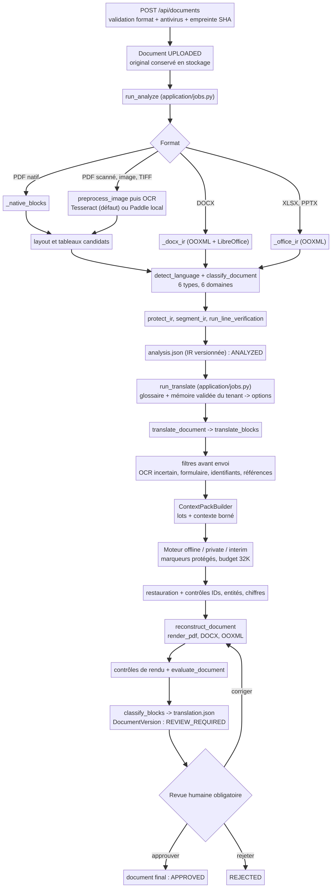
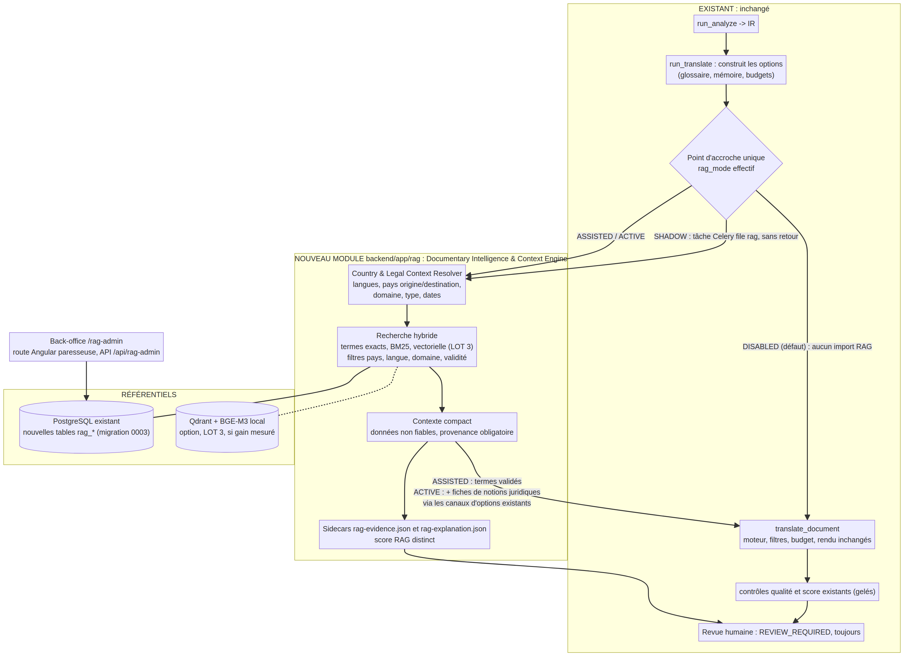
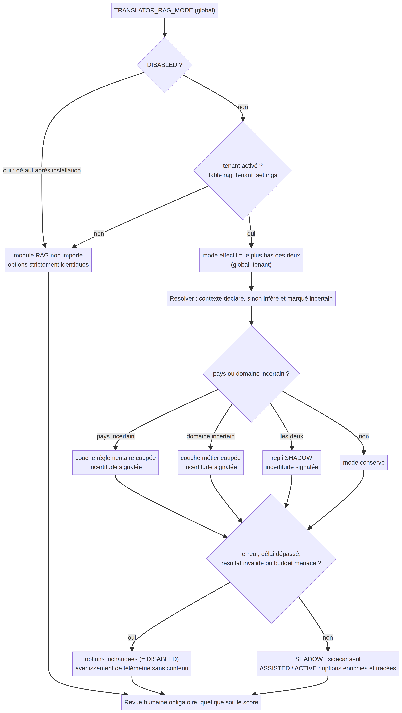

# LOT 0 — Audit de la plateforme existante et architecture cible du RAG

**Module cible : Documentary Intelligence & Context Engine (DICE)**

| Élément | Valeur |
|---|---|
| Statut | Livré **pour validation**. Aucun code écrit, aucun fichier du dépôt modifié. |
| Base auditée | branche `feature/run29-correction-bout-en-bout-20261016`, commit `d8bb59a` (copie en lecture seule, hors dépôt) |
| Date | 30/10/2026 |
| Méthode | 4 audits statiques en parallèle (API/données/configuration/sécurité ; pipeline documentaire ; moteur de traduction et score ; frontend/tests/CI/déploiement), puis contre-vérification directe des points qui conditionnent l'architecture |
| Seules exécutions | collecte des tests (`pytest --collect-only`) et calcul de l'empreinte de règle de mesure (`tools/recette/ruler_fingerprint.py`), sur la copie en lecture seule |
| Référence de non-régression | empreinte de règle actuelle **`b0b0261eaabecda8`** (29 fichiers produit, 5 fichiers outils) ; **874 tests** backend collectés |

---

## 0. Synthèse

La plateforme possède déjà, sans le nommer, l'essentiel des points d'appui dont un RAG a besoin. Le constructeur de contexte (`ContextPackBuilder`) accepte une mémoire documentaire, des décisions de traduction et un contexte pays **fournis par l'appelant**. Il filtre ces éléments par pertinence sur le lot courant et les plafonne : 16 entrées pour la mémoire documentaire, 8 pour les décisions. Le prompt système impose déjà de traiter tout le JSON utilisateur comme une donnée non fiable. Les montants, dates, IBAN, téléphones et nombres sont remplacés par des marqueurs protégés, restaurés puis vérifiés à la sortie du moteur. Un RAG peut donc être ajouté **sans toucher à l'OCR, au moteur de traduction, au rendu ni au score**, en alimentant ces canaux existants depuis la couche applicative.

La contre-vérification a établi un fait décisif. L'empreinte de règle, qui garantit la comparabilité des scores, couvre `builder.py`, `service.py` et `pipeline.py`. Elle **ne couvre pas** `core/settings.py`, `application/jobs.py`, `api/routes.py`, `main.py` ni `core/models.py`. Un point d'accroche unique dans `run_translate` (`application/jobs.py`) laisse donc l'empreinte inchangée. Tous les scores futurs restent comparables aux scores historiques, à règle identique.

Trois risques n'étaient pas apparents et sont intégrés à l'architecture :

1. **Le moteur hors ligne traite le glossaire comme une traduction faisant autorité** : il remplace le bloc par l'entrée du glossaire en cas de correspondance exacte (`service.py:99-107`). Une suggestion RAG placée dans le glossaire deviendrait une traduction imposée. Le RAG ne passera donc **jamais** par le canal `glossary`.
2. **En cas de dépassement de budget, le contexte est retiré dans cet ordre : mémoire de traduction, entités, document, puis mémoire documentaire** (`service.py:837-844`). Ajouter du contexte RAG peut donc évincer des correspondances de mémoire validée utilisées aujourd'hui. Un critère d'acceptation dédié est prévu : zéro éviction de contexte existant.
3. **Le lanceur corpus contourne `jobs.py` et sa clé de cache ignore les options** (`tools/interim_owner_corpus_run.py:113-121`). Les comparaisons A/B/C/D passeront par un **nouveau** lanceur qui partage exactement la même fonction d'injection, avec réutilisation de cache interdite hors `DISABLED`. Le lanceur existant reste intact.

Manques constatés (recherches négatives documentées en annexe B) :

- aucun moteur vectoriel, aucune recherche BM25 ou plein texte ;
- aucune extraction du pays, de la juridiction ou de la date du document ;
- aucun des quatre rôles demandés ;
- aucune référence humaine exploitable pour mesurer un gain de qualité.

**Blocage préexistant, indépendant du RAG.** La CI est rouge depuis le 28/10, uniquement sur les audits de dépendances : 39 vulnérabilités connues dans Pillow 12.3.0, corrigées en 13.0.0, et 6 vulnérabilités élevées côté frontend. Le 16/10, ces audits passaient. Ce point doit être tranché avant le LOT 1 (décision D7).

Le RAG n'enlève jamais la revue humaine : chaque document reste `REVIEW_REQUIRED`, quel que soit le score, et le rapport d'explication RAG est conçu comme un outil pour le relecteur.

---

## 1. Architecture actuelle

| Couche | Constat | Références |
|---|---|---|
| Frontend | Angular 21.2.25, composants standalone, 11 routes **chargées au démarrage** (pas de chargement paresseux), état local et signaux, Vitest. Budget de bundle initial de 2 Mo en erreur. 8 fichiers de specs. | `frontend/src/app/app.routes.ts:1-81`, `frontend/angular.json:22-31` |
| API | FastAPI, un routeur unique préfixé `/api`, **sans versionnement** et **sans `response_model`** : les réponses sont des dictionnaires. Contrat statique `docs/openapi.json`. 21 routes, dont `/health` et `/metrics` hors routeur. | `backend/app/api/routes.py:265-267`, `backend/app/main.py:31-67` |
| Pipeline | Import → validation et antivirus → analyse (natif, OCR, DOCX, XLSX/PPTX) → IR versionnée → traduction par blocs → reconstruction → contrôles → statuts → revue humaine. | `backend/app/documents/pipeline.py`, `backend/app/application/jobs.py` |
| OCR | Tesseract par défaut, Paddle local en option, sans téléchargement. Prétraitement adaptatif, récupération OCR ciblée, double lecture des lignes numériques. | `backend/app/ai/ocr/`, `backend/app/documents/preprocessing.py`, `ocr_recovery.py`, `line_verification.py` |
| Langue | Détection document (script, lexique, `langdetect`), puis raffinement par bloc avec preuves lexicales. | `backend/app/domain/classification.py:121-186`, `backend/app/documents/language_evidence.py` |
| Classification | Classifieur lexical déterministe : **6 types** (attestation de travail, contrat, relevé bancaire, facture, diplôme, formulaire administratif) et **6 domaines** (HR, LEGAL, BANKING, FINANCE, ACADEMIC, ADMINISTRATION). **Aucun pays ni juridiction.** | `backend/app/domain/classification.py:189-504` |
| Extraction | Regex : courriels, IBAN, téléphones, dates multilingues, montants, codes, nombres, plus heuristiques étiquetées. Ce n'est pas un NER complet. | `backend/app/ai/quality/entities.py` |
| Traduction | 3 moteurs, choix fermé `offline`, `private` ou `interim`, sans repli public. Lots de 40 blocs au plus, budget 32 768 = 22 000 en entrée + 8 000 en sortie + 2 768 de marge. Marqueurs protégés, contrôle exact des identifiants. | `backend/app/ai/translation/service.py:29-31, 702-718, 942-1091, 1186-1217` |
| Qualité et score | Contrôles fail-closed. Score v1 gelé (8 dimensions) et v2 gelé (7 dimensions plus une porte de preuves), borne basse officielle, vérificateur arithmétique indépendant, empreinte de règle couvrant la fermeture transitive des modules chargés. | `backend/app/documents/confidence_score*.py`, `tools/recette/` |
| Données | PostgreSQL 16, Alembic `0001_baseline` → `0002_industrial` (tête unique). 9 tables : `tenants`, `users`, `documents`, `document_versions`, `glossary`, `memory`, `audit_events`, `golden_references`, `revoked_sessions`. Les `tenant_id` des tables métier ne sont pas des clés étrangères. | `backend/app/core/models.py`, `backend/migrations/versions/` |
| Objets | Stockage local (protégé contre la traversée de chemin) ou S3/MinIO avec chiffrement côté serveur AES256 ; clés `{tenant}/{document}/…`. | `backend/app/infrastructure/storage.py` |
| Files | Celery sur Redis, une tâche, une file `documents`, 2 jobs (`run_analyze`, `run_translate`), sans retry Celery applicatif. | `backend/app/workers/tasks.py` |
| Configuration | Pydantic Settings, préfixe `TRANSLATOR_`, `.env`, **`extra="ignore"`** : une variable non déclarée est ignorée sans bruit. Validateurs stricts en production. | `backend/app/core/settings.py:14-198` |
| Sécurité | Argon2 ; JWT HS256 avec révocation ; cookie HttpOnly + CSRF + contrôle d'Origin ; **3 rôles** (`uploader`, `reviewer`, `admin`) ; isolation tenant par le code applicatif ; liste blanche d'audit ; appels sortants privés sur liste blanche, IP privée obligatoire, sans proxy ni redirection. | `backend/app/core/security.py`, `backend/app/application/jobs.py:30-72` |
| Observabilité | 2 métriques Prometheus HTTP, identifiant de requête, `/api/health` (base, stockage, Redis) et `/health` minimal. Pas de journalisation structurée ni de traçage distribué. | `backend/app/core/observability.py` |
| Tests | 874 collectés : 837 unitaires, 28 intégration, 3 e2e, 2 régression, 3 sécurité, 1 golden paramétré (corpus privé, ignoré par Git). | `backend/tests/` |
| CI | GitHub Actions : backend (ruff, pytest, pip-audit strict), intégration PostgreSQL 16 + Alembic, frontend (typecheck, test, build, npm audit), manifestes et images ; jobs privés manuels. | `.github/workflows/ci.yml` |
| Déploiement | Compose sur réseau interne (seul le frontend est publié, sur la boucle locale), conteneurs non root en lecture seule ; Helm avec NetworkPolicy fermée par défaut. | `compose.yaml`, `infrastructure/helm/` |

**Absent** (recherches négatives, voir annexe B) :

- pgvector, Qdrant, Elasticsearch/OpenSearch, FAISS, sentence-transformers, BM25 et `tsvector` ;
- tout service vectoriel dans Compose/Helm ;
- toute extraction du pays, de la juridiction, de la date du document ou de la date d'effet ;
- les rôles Administrateur, Responsable terminologique, Responsable juridique et Lecteur ;
- les écrans d'administration des référentiels : `/admin` est purement consultatif.

---

## 2. Flux de traitement actuels

Le flux réel suit 8 étapes.

1. **Import.** `POST /api/documents` lit le fichier par morceaux et le borne en taille. Il valide extension, MIME, signature binaire et contenu actif, passe l'antivirus, calcule l'empreinte SHA-256, range l'original, puis crée le document `UPLOADED` (`routes.py:483-516`).
2. **Analyse.** `run_analyze` revendique atomiquement le document, vérifie l'empreinte et appelle `analyze_document`. Le format est orienté vers la branche PDF natif, OCR, DOCX ou OOXML. Viennent ensuite la langue et la classification, puis `protect_ir` (visuels, tampons, cases), `segment_ir` et `run_line_verification`. L'empreinte est revérifiée et l'IR est écrite (`jobs.py:264-355`, `pipeline.py:770-1037`).
3. **Préparation de la traduction.** `run_translate` charge **le glossaire et la mémoire validée du tenant** et construit le dictionnaire `options` (`jobs.py:397-434`). C'est l'endroit exact où le RAG viendra s'accrocher.
4. **Traduction.** `translate_document` appelle `translate_blocks(ir, options)` (`pipeline.py:1629-1643`). Le service retire d'abord les blocs à ne pas envoyer : OCR incertain, structure de formulaire, identifiants, références, script minoritaire. La source est alors conservée avec un motif explicite. Le service forme ensuite des lots, puis un `pack` de contexte par lot, en copiant les options reçues (`chunk_options = {**options, …}`, `service.py:1251`).
5. **Appel au moteur.** Seuls `id`, texte protégé et langue de chaque bloc sont envoyés, avec un contexte borné ; jamais les coordonnées ni le style (`service.py:1218-1262`). En retour, les identifiants doivent correspondre exactement. Les marqueurs sont restaurés et les suites de chiffres comparées. Toute violation conserve la source et lève une anomalie critique (`service.py:595-646, 1321-1465`).
6. **Reconstruction.** `reconstruct_document` interdit d'écraser l'original, revérifie son empreinte, puis appelle `render_pdf`, la reconstruction DOCX par nœuds `w:t` ou la reconstruction OOXML (`pipeline.py:1344-1395`).
7. **Contrôles et statuts.** Viennent ensuite les contrôles de rendu, `evaluate_document` (entités, couverture, preuves) et `classify_blocks`. Chaque bloc reçoit exactement un statut parmi `TRANSLATED`, `PRESERVED_INTENTIONALLY`, `NOT_TRANSLATABLE`, `UNCERTAIN`, `FAILED` et `NOT_PROCESSED`. Une version immuable est créée et le document passe en `REVIEW_REQUIRED` (`block_status.py:30-217`, `jobs.py:517-577`).
8. **Revue humaine.** Elle est obligatoire. L'écran présente 4 panneaux : original, image prétraitée, candidat, différences. Les décisions possibles sont corriger (nouvelle version, reconstruction et réévaluation), rejeter ou approuver ; l'approbation exige l'attestation, la couverture complète des identifiants et zéro erreur critique (`routes.py:657-858`).

---

## 3. Composants réutilisables

| Composant existant | Réutilisation par le RAG | Référence |
|---|---|---|
| Patron `Literal` de `Settings` | Ajout de `rag_mode` et `rag_admin_enabled` sur le même modèle, validés au démarrage | `settings.py:27, 36, 46` |
| `ContextPackBuilder.relevant_context` | Canaux `document_memory` (terminologie et décisions, 16 entrées), `decisions` (8) et `country_context`. **Filtrage par pertinence sur le lot courant et plafonds déjà en place** : le contexte compact est garanti sans nouveau code de sélection. | `builder.py:269-383` |
| `_fit_prompt_to_budget` | Retrait automatique du contexte en cas de dépassement, avec le tokenizer réel. À instrumenter côté RAG (risque R4). | `service.py:816-857` |
| Règle anti-injection du prompt système | Base de la protection : le contexte RAG est transmis comme donnée JSON structurée, jamais comme instruction | `service.py:786-801` |
| Marqueurs protégés et invariants numériques | Montants, dates, IBAN, numéros et chiffres restent garantis quel que soit le contexte RAG | `service.py:527-646` |
| Tables `glossary` et `memory` versionnées par tenant | Source de vérité client prioritaire sur le RAG, inchangée | `models.py:104-127` |
| Graines terminologiques par domaine (5 domaines) | Point de départ de la taxonomie métier RAG (10 domaines), par correspondance et non par modification | `ai/context/terminology.py:11-38` |
| Classifieur `document_type` / `domain` | Entrée du Resolver ; `unknown` ou ambigu déclenche une réduction d'injection | `classification.py:421-504` |
| Télémétrie et provenance par bloc (requêtes, jetons, modèle servi) | Mesure des jetons, du coût et de la latence des modes C/D ; sous-objet `rag` versionné ajouté | `service.py:860-939` |
| Audit par liste blanche | Traçabilité des recherches et validations sans contenu | `jobs.py:30-72` |
| Stockage préfixé avec chiffrement côté serveur | Préfixe dédié `rag/` pour les PDF réglementaires et les sidecars | `storage.py:59-84` |
| Celery | Nouvelle file `rag` (indexation, mode SHADOW), sans toucher à la file `documents` | `workers/tasks.py` |
| Fournisseur d'embeddings local de la qualité | Patron de chargement local de poids préinstallés, sans téléchargement | `ai/quality/providers.py:75-222` |
| Outils de non-régression | `compare_baseline.py`, `measure_v2.py`, `measure_corpus_metrics.py`, `compare_runs_sheets.py`, `ruler_fingerprint.py`, `score_verify.py` pour prouver que `DISABLED` est identique | `tools/`, `tools/recette/` |
| Écran de revue | Affichage ultérieur du rapport d'explication RAG au relecteur, par un composant ajouté | `frontend/src/app/pages/review.page.ts` |

---

## 4. Points d'extension recommandés

### 4.1 Règle de conception

Le module est un paquet autonome `backend/app/rag/` : Resolver, recherche, constructeur de contexte, politique de modes, sidecars, API, tâches. Les dépendances vont **dans un seul sens**. `app.rag` peut lire des types existants, mais aucun module de la fermeture de mesure (pipeline, service, builder, statuts, qualité, rendu) n'importe `app.rag`. Un test automatique vérifie cette règle et vérifie que l'empreinte de règle reste `b0b0261eaabecda8`.

### 4.2 Fermeture de l'empreinte de règle (mesurée)

| Fichier | Dans l'empreinte ? | Conséquence |
|---|---|---|
| `backend/app/ai/context/builder.py` | **oui** | ne pas modifier |
| `backend/app/ai/translation/service.py` | **oui** | ne pas modifier |
| `backend/app/documents/pipeline.py` | **oui** | ne pas modifier |
| `backend/app/core/settings.py` | non | ajout de champs possible sans rupture de comparabilité |
| `backend/app/application/jobs.py` | non | point d'accroche retenu |
| `backend/app/api/routes.py`, `backend/app/main.py` | non | inclusion conditionnelle d'un routeur possible |
| `backend/app/core/models.py` | non | les modèles RAG vont dans un fichier séparé |
| `backend/app/ai/context/terminology.py` | non (import tardif) | ne pas modifier par principe |

### 4.3 Points de branchement retenus

| # | Point | Nature | Justification |
|---|---|---|---|
| P1 | `run_translate`, juste après la construction de `options` (`jobs.py:414-434`) | ~8 lignes ajoutées dans un fichier existant | Seul endroit où le document, le tenant, le glossaire et les options sont réunis **avant** la traduction, hors empreinte de règle. En `DISABLED`, une seule comparaison de chaîne : le module n'est pas importé et `options` n'est pas touché. |
| P2 | Nouveau lanceur `tools/rag_corpus_run.py` | nouveau fichier | Le lanceur existant appelle `translate_document` directement (`interim_owner_corpus_run.py:26`) et ne passe pas par P1. Le nouveau appelle **la même fonction** `app.rag.integration.augment_options` que P1 : même logique en production et en recette. |
| P3 | Mode SHADOW : tâche Celery sur une nouvelle file `rag`, envoyée depuis P1 sans attente de retour | nouveau code, file séparée | La recherche n'est pas sur le chemin critique de traduction et ne peut ni la ralentir ni la modifier. En exécution inline (tests), elle est exécutée après coup et ses erreurs sont absorbées. |
| P4 | Routeurs `/api/rag/*` et `/api/rag-admin/*`, inclus dans `main.py` **seulement si** `rag_admin_enabled=true` | 3 lignes ajoutées dans `main.py` | Ajout pur. Flag désactivé : l'OpenAPI générée est identique à l'actuelle. Les routes existantes et leurs réponses ne changent pas. |
| P5 | Migration Alembic `0003_rag` | nouveau fichier | Uniquement de nouvelles tables `rag_*`, aucune colonne ajoutée aux 9 tables existantes ; le downgrade ne supprime que les tables `rag_*`. |
| P6 | Route Angular paresseuse `rag-admin` (`loadChildren`) et entrée de menu conditionnelle | 1 route + 1 entrée de menu ajoutées dans 2 fichiers existants | Le bundle initial ne change pas. Le menu ne s'affiche que si l'API déclare le back-office activé. |
| P7 | Profil Compose `rag`, valeur Helm `rag.enabled: false` | ajouts dans `compose.yaml` et Helm | Sans profil et sans valeur activée, le déploiement par défaut est identique. Qdrant et l'embedding n'y apparaissent qu'au LOT 3, et seulement si le gain est démontré. |

### 4.4 Canaux utilisés pour transmettre le contexte (sans modifier le moteur)

| Canal existant | Utilisation RAG | Mode | Pourquoi |
|---|---|---|---|
| `glossary` | **Jamais** | — | Le moteur hors ligne l'applique comme une traduction imposée (`service.py:99-107`) ; c'est aussi la priorité client. |
| `document_memory.terminology` | Équivalences validées : terme source, cible, domaine, pays, statut, provenance, mention « suggestion non autoritaire » | ASSISTED, ACTIVE | Filtré par pertinence sur le lot, plafonné à 16, retirable sous contrainte de budget (`builder.py:309-326`) |
| `document_memory.translation_decisions` | Fiches de notion juridique compactes : notion du pays source, référence officielle, consigne « conserver la notion d'origine, ne pas substituer le droit du pays destinataire » | ACTIVE | Contexte réglementaire ciblé, jamais un texte intégral |
| `country_context` | Pays d'origine et de destination, date de référence juridique | ACTIVE | Déjà prévu par `pack` (`builder.py:379`), aujourd'hui jamais renseigné |
| Prompt système, blocs, `translations`, statuts | **Jamais** | — | Toucher ces éléments changerait l'empreinte, le protocole de sortie ou masquerait des incertitudes. |

Budget proposé, à calibrer au LOT 5 : au plus 800 jetons RAG par requête en ASSISTED et 1 500 en ACTIVE, soit 3,64 % et 6,82 % des 22 000 jetons d'entrée. Le plafond de 40 blocs par lot ne change pas.

### 4.5 Architecture cible

### 4.6 Country & Legal Context Resolver

Le Resolver produit un objet versionné : langue source, langue cible, pays d'origine, pays de destination, domaine, type de document, date du document, date de référence juridique. Chaque champ porte son **origine** (`declared`, `inferred` ou `unknown`) et une confiance.

L'origine `declared` provient d'un nouvel endpoint `PUT /api/rag/documents/{id}/context`, ce qui laisse le contrat d'import inchangé. L'origine `inferred` provient de l'IR existante : langue, `document_type` et `domain` du classifieur. Aucun pays n'est inventé. Une inférence de pays à partir d'indices du document (script, mentions d'organismes, formats d'identifiants) reste toujours marquée `inferred` avec une faible confiance. Le Resolver n'écrit jamais dans l'IR.

**Exemple : contrat de travail marocain, arabe vers français, Maroc vers France.** L'ordre de priorité est le suivant :

1. la terminologie juridique marocaine validée, y compris les équivalents de l'édition de traduction officielle en français du Bulletin officiel ;
2. le vocabulaire administratif français pour la formulation ;
3. les équivalences linguistiques générales.

Une notion du droit marocain sans équivalent exact produit une fiche « conserver la notion d'origine ». Une explication distincte n'est ajoutée qu'en ACTIVE et si le référentiel la valide. Aucune équivalence vers une notion du droit français n'est proposée, sauf si elle est enregistrée et validée comme correspondance entre juridictions.

**Incertitude.** L'injection est réduite **par couche** plutôt que d'inventer un contexte :

- pays incertain → couche réglementaire coupée ;
- domaine incertain → couche métier coupée ;
- les deux → repli SHADOW.

L'incertitude est toujours signalée dans le rapport d'explication.

### 4.7 Recherche hybride et choix technologiques

| Besoin | Existant | Recommandation | Alternative écartée et raison |
|---|---|---|---|
| Métadonnées, versions, validation, historique | PostgreSQL 16 | **PostgreSQL existant**, nouvelles tables `rag_*` | — |
| Recherche exacte de termes | aucune | **PostgreSQL**, index B-tree sur une forme normalisée : Unicode NFKC et casse ; pour l'arabe, suppression des diacritiques et unification des variantes de lettres. À spécifier au LOT 2. | — |
| Lexicale BM25 | aucune | **BM25 implémenté dans le module** sur les entrées des référentiels (LOT 2), puis sur les passages réglementaires (LOT 3) | `pg_textsearch` (BM25 natif) exige PostgreSQL 17 ou 18 et `shared_preload_libraries` ; la pile est en PostgreSQL 16. Le classement plein texte natif de PostgreSQL n'est pas du BM25. |
| Vectorielle | aucune | **Décision reportée au LOT 3, sur mesure.** Plan par défaut : Qdrant (Apache-2.0, vecteurs denses et creux, fusion hybride RRF/DBSF, filtres sur métadonnées) en **service séparé et optionnel**, avec BGE-M3 (licence MIT, plus de 100 langues, jusqu'à 8 192 jetons, dimension 1 024) à poids locaux préinstallés. **Introduit seulement si un gain mesuré sur BM25 est démontré** : la fiche BGE-M3 indique elle-même que BM25 reste une référence compétitive. | pgvector (PostgreSQL 13+) éviterait un nouveau service, mais il faut installer l'extension dans la base **partagée** avec la plateforme. Cela change l'image Compose ; avec Helm, la base est externe et l'installation relève d'un DBA. La charge d'indexation pèserait sur la base de production. Licence non vérifiée à ce stade. |
| Filtres pays, langue, domaine, validité | — | Colonnes indexées en SQL ; métadonnées filtrables côté Qdrant s'il est retenu | — |
| Priorité aux sources officielles et glossaires validés | — | Score final = pertinence × poids de statut. Seules les entrées validées et publiées sont injectables ; les brouillons ne servent qu'à la recherche de test du back-office. | — |
| Service | FastAPI | **Même application FastAPI et même image** aux LOTS 1-2 : pas de nouveau microservice | Microservice séparé : possible plus tard sans changer le contrat interne (décision D4) |

Chaque résultat de recherche renvoie : passage ou équivalence, source, pays, langue, version, dates de validité, score de pertinence, statut de validation, identifiant de provenance.

### 4.8 Modèle de données des référentiels (esquisse, spécification détaillée au LOT 1)

Toutes les tables sont nouvelles, préfixées `rag_`, et portent une clé étrangère `tenant_id` vers `tenants`. Les tables existantes ne sont pas modifiées.

| Table | Contenu principal |
|---|---|
| `rag_referential` | type (linguistique, métier, réglementaire), domaine (taxonomie des 10 domaines demandés), pays, juridiction, langues, actif/inactif, propriétaire, portée (tenant ou bibliothèque commune en lecture seule) |
| `rag_referential_version` | numéro, statut (`draft`, `in_review`, `published`, `retired`), auteur, validateur, dates, empreinte du contenu importé |
| `rag_term_entry` | langue et terme source, forme normalisée, langue et terme cible, synonymes, variante régionale, registre, définition, note d'usage, domaine, pays, statut |
| `rag_legal_text` | **les 11 métadonnées obligatoires** : pays, juridiction, domaine juridique, type de texte, référence officielle, date de publication, date d'entrée en vigueur, date de fin de validité, version, source officielle, statut de validation ; plus la langue et la clé d'objet du PDF |
| `rag_legal_passage` | texte, article ou section, langue, référence de passage, rattachement à `rag_legal_text` |
| `rag_notion_equivalence` | notion, pays source et cible, type (`exacte`, `approchée`, `sans équivalent`), consigne, statut de validation |
| `rag_validation_event`, `rag_change_log` | historique des validations et des modifications (qui, quand, quoi), sans texte de document client |
| `rag_document_context` | contexte déclaré par document et par version (pays, dates), avec sa provenance |
| `rag_tenant_settings` | mode maximal autorisé par tenant (défaut `DISABLED`) |
| `rag_role_assignment` | rôles RAG par utilisateur et tenant, séparés de `users.role` |
| `rag_search_log` | traçabilité des recherches : empreinte de la requête, filtres, nombre et identifiants des résultats, latence, mode. **Jamais le texte de la requête.** |

### 4.9 APIs du module (esquisse)

| Interface | Rôle |
|---|---|
| `app.rag.integration.augment_options(options, ir, ctx, mode) -> options` | Fonction pure partagée par P1 et P2. Elle renvoie **le même objet** en `DISABLED` et en SHADOW, et une copie enrichie et tracée en ASSISTED/ACTIVE. |
| `ContextEngine.resolve(request) -> RagContext` | Interface interne : Resolver, recherche, contexte compact, sidecars |
| `GET /api/rag/status` | mode global et mode du tenant ; répond `disabled` sans erreur |
| `GET` et `PUT /api/rag/documents/{id}/context` | contexte déclaré (pays, dates), avec contrôle tenant et propriétaire via la logique existante |
| `GET /api/rag/documents/{id}/explanation?version=n` | rapport d'explication pour le relecteur |
| `POST /api/rag/search` | recherche terminologique de test, réservée aux rôles RAG |
| `/api/rag-admin/referentials…` | création, versions, imports CSV/XLSX/PDF, validation et publication, historique, obsolescence |

### 4.10 Score RAG distinct et rapport explicatif

Les sidecars `rag-evidence.json` et `rag-explanation.json` sont écrits sous un préfixe séparé, **après** le score existant. Ils ne figurent dans aucun fichier lu par `scorecard.py`, `scorecard_v2.py` ou `measure_v2.py`. Les fichiers gelés v1/v2 ne sont pas touchés.

Le score RAG porte sa propre version et mesure :

- la couverture des termes reconnus et la conformité des cibles aux référentiels ;
- les conflits et ambiguïtés signalés ;
- les notions juridiques conservées ;
- la complétude de la provenance.

Il n'est jamais agrégé au score global.

Le rapport d'explication liste, par identifiant de bloc :

- les termes pour lesquels le RAG a été utilisé, les sources récupérées et les équivalences proposées ;
- la variante retenue par le moteur, quand elle est observable ;
- les ambiguïtés, avec plusieurs traductions possibles ;
- les éléments à valider humainement.

### 4.11 Back-office et rôles

Le back-office est un espace Angular paresseux et indépendant (`pages/rag-admin/`, `core/rag-admin/`). Il ne réutilise aucun état des écrans de traduction ou de revue.

| Rôle | Droits |
|---|---|
| Administrateur RAG | modes par tenant, activation des référentiels, attribution des rôles |
| Responsable terminologique | dictionnaires et glossaires métier : import, versions, publication |
| Responsable juridique | textes réglementaires : import, validation, publication ; seul rôle à pouvoir publier une source réglementaire |
| Lecteur | consultation et recherche de test |

**Aucune publication automatique** : `published` exige un événement de validation par un rôle habilité, et un test le vérifie.

---

## 5. Risques de régression

| # | Risque | Cause précise | Mitigation | Preuve automatisée |
|---|---|---|---|---|
| R1 | `DISABLED` non strictement identique | effet de bord d'import, mutation de `options` | import tardif dans la branche active ; `options` jamais modifié en place | test JSON canonique de `options` (variable absente ou `DISABLED`) ; A/B sur les 8 originaux |
| R2 | Dérive de l'empreinte de règle | import de `app.rag` depuis un module mesuré | règle d'import à sens unique | test : empreinte = `b0b0261eaabecda8` |
| R3 | Incertitudes masquées | texte RAG dans `translations` ou les statuts | le RAG n'écrit ni traduction ni statut ; les filtres avant envoi restent en amont | test : statuts identiques à A pour les blocs `UNCERTAIN`/`FAILED` |
| R4 | Éviction de contexte existant | ordre de retrait : mémoire, entités, document, puis mémoire documentaire (`service.py:837-844`) | budget RAG plafonné ; avant chaque document, rejeu hors ligne de `build_chunks` + `pack` + retrait de contexte avec le tokenizer du moteur ; réduction des entrées RAG tant qu'une éviction est prévue | critère : 0 élément de contexte existant retiré à cause du RAG sur les 8 originaux |
| R5 | Contamination du cache inter-exécutions | signature d'envoi sans les options (`interim_owner_corpus_run.py:113-121`) | nouveau lanceur ; réutilisation interdite hors `DISABLED` | test de refus |
| R6 | Suggestion transformée en traduction imposée | glossaire appliqué tel quel par le moteur hors ligne | canal `glossary` interdit au RAG | test : `options["glossary"]` identique dans tous les modes |
| R7 | Injection de prompt via les textes récupérés | contenu réglementaire importé | champs structurés seulement ; longueurs bornées ; délimiteurs neutralisés ; rejet des passages contenant des consignes ; provenance obligatoire ; règle « donnée non fiable » du prompt existant | jeu de passages adverses |
| R8 | Substitution du droit du pays destinataire | équivalence approximative | priorité au pays source ; fiche « conserver la notion » ; équivalence entre juridictions seulement si validée | cas MA→FR, FR→ES… |
| R9 | Fuite entre tenants | `tenant_id` non clé étrangère dans l'existant | clé étrangère et filtre obligatoires sur toutes les tables `rag_*` ; bibliothèque commune en lecture seule | tests inter-tenants |
| R10 | Image backend alourdie | client vectoriel, torch, poids | `requirements-rag.txt` optionnel ; services séparés ; `requirements.txt` inchangé | build de l'image par défaut identique |
| R11 | Temps de traitement sans RAG | appel au Resolver | aucun appel en `DISABLED` ; SHADOW hors chemin critique | médiane de 3 rejeux, dans la dispersion de référence (seuil proposé : +2 %) |
| R12 | Données sensibles dans les journaux | requêtes de recherche | empreintes et compteurs seulement ; liste blanche d'audit | scanner de journaux |
| R13 | Bundle frontend | écran ajouté au démarrage | route paresseuse | budget 2 Mo et taille du bundle initial identique |
| R14 | Score gonflé | preuve RAG lue par le score existant | sidecars hors des entrées des calculateurs | empreinte et scores identiques à règle égale |
| R15 | CI déjà rouge | audits Pillow et frontend (préexistant) | lot de maintenance séparé (D7) | CI verte avant le LOT 1 |

---

## 6. Stratégie d'intégration sans rupture

### 6.1 Matrice des modes

| | DISABLED (défaut) | SHADOW | ASSISTED | ACTIVE |
|---|---|---|---|---|
| Module RAG importé | non | oui, dans une tâche séparée | oui | oui |
| Recherche exécutée | non | oui, file `rag` | oui | oui |
| `options` modifié | **non** | **non** | `document_memory.terminology` | + `translation_decisions`, `country_context` |
| Prompt envoyé au moteur | identique | identique | + termes compacts | + termes et fiches de notions |
| Sidecars et score RAG | non | oui | oui | oui |
| Latence de traduction | identique | identique (hors chemin) | + recherche | + recherche |
| Revue humaine | obligatoire | obligatoire | obligatoire + rapport | obligatoire + rapport |

### 6.2 Verrous et repli

Le mode effectif passe trois verrous :

1. la variable globale `TRANSLATOR_RAG_MODE`, `DISABLED` par défaut ;
2. l'activation explicite du tenant, également `DISABLED` par défaut ;
3. la réduction par le Resolver en cas d'incertitude.

**Repli :** toute erreur, tout délai dépassé, tout résultat invalide ou tout risque d'éviction renvoie des `options` inchangées, avec un avertissement de télémétrie sans contenu. La traduction se poursuit alors exactement comme aujourd'hui. Aucun traitement existant n'est activé automatiquement.

### 6.3 Protocole de preuve « DISABLED identique » (à chaque lot)

1. **Tests.** Les 874 tests existants passent, ainsi que les nouveaux, avec la commande CI exacte.
2. **Règle de mesure.** L'empreinte reste `b0b0261eaabecda8`, et les fichiers gelés v1/v2 ont des empreintes identiques.
3. **Corpus.** Les 8 originaux autorisés sont rejoués hors ligne, à mémoire figée, sans aucune requête : avant ajout du module et après, avec `DISABLED`.
4. **Critères d'égalité sur le corpus :**
   - `analysis.json`, `translation.json`, statuts, anomalies et télémétrie identiques en JSON canonique, hors horodatages et durées ;
   - aperçus identiques au pixel ;
   - empreintes des originaux inchangées.
5. **Contrat API.** L'OpenAPI générée est identique avec le flag désactivé.
6. **Frontend.** Specs, typecheck et build passent, avec un bundle initial de taille identique.
7. **Temps.** La médiane de 3 rejeux reste dans la dispersion de référence.

Une référence absente donne `NOT_EVALUATED`, jamais une réussite.

### 6.4 Rollback

Remettre `TRANSLATOR_RAG_MODE=DISABLED` et redémarrer : le comportement antérieur est rétabli, puisque le module n'est plus importé. Si nécessaire, `alembic downgrade` vers `0002_industrial` supprime uniquement les tables `rag_*`. Côté déploiement, il suffit de retirer le profil Compose `rag` ou de remettre `rag.enabled: false` dans Helm. Les traitements historiques ne sont jamais réécrits : les sidecars sont des fichiers séparés et les versions documentaires existantes restent immuables.

### 6.5 Modifications de fichiers existants indispensables (validation demandée)

| Fichier | Modification | Ampleur estimée | Pourquoi indispensable | Effet en `DISABLED` |
|---|---|---|---|---|
| `backend/app/core/settings.py` | + `rag_mode`, + `rag_admin_enabled` (`Literal`, défauts désactivés) | ~4 lignes | `extra="ignore"` ferait ignorer une variable non déclarée | aucun |
| `backend/app/application/jobs.py` | accroche P1 : condition + import tardif + appel | ~8 lignes | seul point avant traduction hors empreinte | une comparaison de chaîne |
| `backend/app/main.py` | inclusion conditionnelle des 2 routeurs | ~3 lignes | exposer l'API RAG sans toucher au routeur existant | aucune route ajoutée |
| `frontend/src/app/app.routes.ts` | 1 route paresseuse | ~5 lignes | point d'entrée du back-office | bundle initial inchangé |
| `frontend/src/app/app.component.ts` | 1 entrée de menu conditionnelle | ~3 lignes | navigation | entrée masquée |
| `compose.yaml`, Helm (`values.yaml`, gabarits) | services sous profil `rag` ; `rag.enabled: false` | ajouts | déploiement privé optionnel (LOT 3/8) | déploiement identique |

Tout le reste est constitué de **fichiers nouveaux** : `backend/app/rag/**`, migration `0003_rag`, `backend/tests/**/test_rag_*`, `tools/rag_corpus_run.py`, `frontend/src/app/{pages,core}/rag-admin/**`, `docs/rag/**`, `requirements-rag.txt`. Les nouveaux tests sont collectés par la commande CI existante, sans modifier le workflow.

### 6.6 Plan des lots

Chaque lot livre tests automatisés, documentation technique, démonstration et rollback ; le protocole 6.3 s'applique à chaque fois.

| Lot | Contenu | Critères d'acceptation spécifiques |
|---|---|---|
| 1 — Module indépendant | squelette `app.rag`, flags, migration `0003` (tables vides), interfaces, `augment_options` neutre, file `rag`, lanceur `rag_corpus_run.py` | protocole 6.3 complet ; test d'isolation des imports ; upgrade et downgrade `0003` sur PostgreSQL 16 réel en CI |
| 2 — Linguistique et glossaires métier | référentiels en arabe, français, anglais, espagnol et allemand ; 10 domaines ; import CSV/XLSX ; recherche exacte + BM25 ; normalisation arabe ; SHADOW | rappel et précision sur un jeu de termes annoté ; isolation tenant ; sorties métier SHADOW = A |
| 3 — Réglementaire France et Maroc | 11 métadonnées obligatoires ; import PDF, passages, validation ; décision vectorielle sur mesure comparative | 0 publication sans validation ; filtrage de validité ; provenance complète ; gain vectoriel démontré, sinon non introduit |
| 4 — Resolver | contexte déclaré ou inféré, origines, réduction par couche | jeu de cas multi-pays ; 0 substitution du droit du pays destinataire ; incertitude toujours signalée |
| 5 — Intégration contrôlée | ASSISTED puis ACTIVE par les canaux de 4.4 ; anti-injection ; budget ; rapport d'explication | 0 éviction de contexte existant ; invariants d'entités inchangés ; activation par tenant uniquement |
| 6 — Back-office | écrans paresseux, 4 rôles, versions, validation, historique, recherche de test, obsolescence | specs et tests de contrat ; tests RBAC ; bundle initial inchangé |
| 7 — Comparatifs A/B/C/D | mêmes documents, paramètres et modèle ; fidélité, exhaustivité, terminologie, droit, format, hallucinations, temps, jetons, coût ; erreurs critiques comptées à part | 0 régression en A ; gain affirmé seulement avec références humaines, sinon « non démontré » |
| 8 — Déploiement progressif | profils, guide de déploiement privé, exercice de rollback, tenant pilote en SHADOW | rollback chronométré et vérifié ; aucun tenant activé par défaut |

### 6.7 Prérequis et limites connus

- **Références humaines.** Le corpus des 8 originaux n'a aujourd'hui aucune ligne de référence humaine (0/1072). Un gain de fidélité, de terminologie ou de droit ne pourra être *démontré* qu'avec une liste annotée de termes et notions attendus par document. Sans elle, le LOT 7 ne produira que des indicateurs indirects, présentés comme tels.
- **Moteur pour C/D.** Le moteur hors ligne ne fait que des correspondances exactes : il ne peut pas tirer parti d'un contexte. Le Qwen privé n'est toujours pas disponible ; le fournisseur temporaire exige une autorisation valide, à renouveler ; gpt-oss local n'est pas qualifié. Les modes A et B peuvent être prouvés hors ligne ; C et D exigent un moteur génératif autorisé, identique pour les 4 passes.
- **Sources juridiques.**
  - **France :** l'API Légifrance passe par le portail PISTE, avec inscription au nom de l'organisation, Licence Ouverte 2.0, CGU et quotas. L'import se fait par une procédure d'administration hors ligne ; aucun document client n'est transmis.
  - **Maroc :** le Bulletin officiel est publié en PDF, avec une édition générale en arabe et une **édition de traduction officielle en français**, précieuse pour l'arabe → français. Aucune API ni licence de réutilisation n'est affichée : une validation juridique est nécessaire.
  - **Royaume-Uni, Espagne, Allemagne, Belgique et pays du Golfe :** non audités dans ce lot.
- **Corpus de validation.** Un corpus multilingue **synthétique** (contrats, attestations, bulletins de paie, documents bancaires, administratifs, juridiques, tableaux, scans, tampons) est à constituer sans aucune donnée réelle, en complément des 8 originaux qui restent privés.

---

## 7. Décisions à valider avant le LOT 1

| # | Décision | Recommandation |
|---|---|---|
| D1 | Point d'accroche unique dans `run_translate` et liste des modifications de la section 6.5 | Valider |
| D2 | Sémantique des modes : ASSISTED = termes validés seulement ; ACTIVE = termes + fiches de notions + contexte pays ; canal glossaire interdit | Valider |
| D3 | Technologies : PostgreSQL existant + BM25 dans le module aux LOTS 1-2 ; Qdrant + BGE-M3 décidés au LOT 3 sur gain mesuré | Valider |
| D4 | Module dans la même application FastAPI et la même image (pas de nouveau microservice) | Valider |
| D5 | Rôles RAG dans une table séparée ; textes officiels en bibliothèque commune en lecture seule, glossaires par tenant | Valider |
| D6 | Branche de travail : nouvelle branche empilée sur RUN29 (`d8bb59a`), PR en brouillon uniquement, sans fusion | Valider |
| D7 | CI rouge sur les audits : lot de maintenance **séparé et préalable** (Pillow 13, version majeure utilisée par le rendu, avec preuve d'identité au pixel sur les 31 pages ; correctif Angular), ou exception temporaire documentée | Lot séparé préalable |
| D8 | Références humaines pour le LOT 7 : fournies par vos équipes, ou acceptation que le gain sera seulement indirect | À arbitrer |

---

## Annexe A — Sources externes vérifiées (30/10/2026)

| Source | Points vérifiés |
|---|---|
| [BGE-M3 (fiche officielle)](https://huggingface.co/BAAI/bge-m3) | licence MIT ; représentations dense, multi-vecteur et creuse ; plus de 100 langues ; jusqu'à 8 192 jetons ; dimension 1 024 ; recommande l'hybride et le reclassement ; BM25 reste une référence compétitive |
| [Qdrant (dépôt officiel)](https://github.com/qdrant/qdrant) | Apache-2.0 ; vecteurs denses, creux et multi-vecteurs ; filtres sur métadonnées ; fusion hybride RRF/DBSF ; multi-tenant ; déploiement par défaut **sans authentification**, à sécuriser |
| [pgvector (dépôt officiel)](https://github.com/pgvector/pgvector) | PostgreSQL 13+ ; HNSW/IVFFlat ; hybride avec le plein texte documenté ; licence non vérifiée |
| [pg_textsearch (dépôt officiel)](https://github.com/timescale/pg_textsearch) | BM25 ; PostgreSQL 17 et 18 seulement ; `shared_preload_libraries` requis |
| [Légifrance, open data et API](https://www.legifrance.gouv.fr/contenu/pied-de-page/open-data-et-api) | réutilisation gratuite ; API via PISTE après inscription ; Licence Ouverte 2.0 ; CGU et quotas |
| [SGG Maroc, Bulletin officiel](https://www.sgg.gov.ma/BulletinOfficiel.aspx) | 6 éditions, dont l'édition générale en arabe et l'édition de traduction officielle en français ; PDF ; pas d'API ni de licence de réutilisation affichée |

## Annexe B — Notes détaillées des audits

Les 4 notes d'audit, avec toutes les références `fichier:ligne` et les recherches négatives (motifs recherchés), sont jointes :

- `annexes/A-api-donnees-config.md`
- `annexes/B-pipeline-documentaire.md`
- `annexes/C-traduction-qualite-score.md`
- `annexes/D-frontend-tests-ci-deploiement.md`

## Annexe C — Observations hors périmètre (signalées, non corrigées)

Il s'agit de constats sur l'existant. Ils ne seront **pas** corrigés dans le cadre du RAG, faute de demande explicite et pour éviter tout remaniement opportuniste :

- `TRANSLATOR_AV_SCAN_REQUIRED` (Compose) et `TRANSLATOR_AV_SCAN_URL` (Helm) ne sont pas lus par le backend ;
- les sondes Kubernetes utilisent `/health`, qui ne vérifie ni la base, ni le stockage, ni Redis ;
- `GET /api/audit` est lisible par tout rôle authentifié du tenant ;
- les rôles déclarés côté UI (`operator`, `viewer`) ne correspondent pas au rôle backend `uploader` ;
- une exception du pipeline peut placer son message brut dans `issues`, exposé par l'API ;
- les `tenant_id` des tables métier ne sont pas des clés étrangères ;
- `AUTO_CREATE_SCHEMA` vaut `true` par défaut dans Compose, alors que le validateur le refuse en production.
