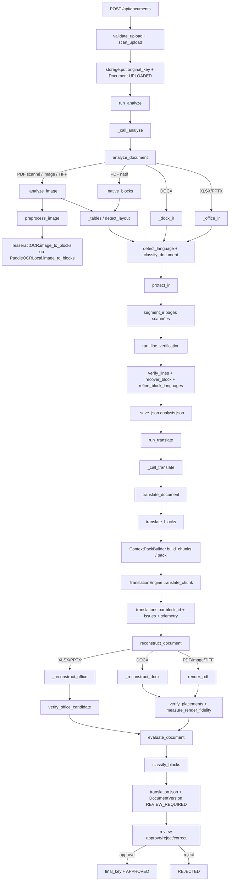

# Audit lecture seule — pipeline documentaire de bout en bout

**Périmètre et méthode.** Audit statique du snapshot présent sous `backend/app` (analyse sans exécution du pipeline, sans document client, sans réseau et sans modification du code). Les références ci-dessous sont des chemins relatifs au snapshot et des numéros de ligne.

## 1. Cartographie du flux de bout en bout

### 1.1 Entrées et orchestration

1. L’import HTTP est `POST /api/documents` (`backend/app/api/routes.py:483-516`). Le fichier est lu par morceaux, borné par `settings.max_upload_bytes`, puis soumis à `validate_upload`, à l’antivirus `scan_upload`, haché, rangé dans le stockage sous `original_key`, créé en base avec l’état initial `UPLOADED`, puis `run_analyze` est lancé selon le mode d’exécution (`backend/app/api/routes.py:487-514`).
2. Les actions explicites `POST /documents/{id}/analyze` et `POST /documents/{id}/translate` passent par `process`, refusent un job concurrent et appellent `run_or_queue` (`backend/app/api/routes.py:544-559`). `run_or_queue` exécute inline, en background ou via `enqueue` selon la configuration (`backend/app/api/routes.py:322-333`).
3. En mode Celery, `enqueue` envoie le nom de job, l’identifiant documentaire, le tenant et l’acteur dans la queue `documents`; `execute` initialise DB et stockage puis sélectionne `run_analyze` ou `run_translate` (`backend/app/workers/tasks.py:11-45`).

### 1.2 Analyse / IR

4. `run_analyze` revendique atomiquement le document, passe à `ANALYZING`, réinitialise les résultats de translation/qualité et matérialise une copie de l’original dans le workspace (`backend/app/application/jobs.py:264-315`). Il vérifie le SHA source avant de commencer l’analyse (`backend/app/application/jobs.py:296-300`).
5. `analyze_document` résout le chemin de travail, contrôle l’existence et l’extension dans `SUPPORTED` (`.pdf`, images, `.docx`, `.xlsx`, `.pptx`), calcule l’empreinte source et crée le dossier de previews (`backend/app/documents/pipeline.py:28-29`, `backend/app/documents/pipeline.py:770-780`).
6. Les branches Office sont sélectionnées avant la branche PDF/image : XLSX/PPTX appellent `_office_ir` (`backend/app/documents/pipeline.py:781-793`), DOCX appelle `_docx_ir` (`backend/app/documents/pipeline.py:794-809`), les autres formats passent par PyMuPDF/Pillow (`backend/app/documents/pipeline.py:810-815`).
7. Pour un PDF, chaque page est extraite nativement par `_native_blocks`; une page est considérée scannée si le texte natif n’est pas significatif (`backend/app/documents/pipeline.py:825-828`). La page est rasterisée à 1x pour le natif ou 2x pour le scanné; le scanné mesure aussi le style sur un rendu 4x (`backend/app/documents/pipeline.py:831-850`).
8. Une page scannée passe par `_analyze_image`, donc `preprocess_image`, OCR, retour des coordonnées vers la source, style mesuré sur le raster original et régions visuelles candidates (`backend/app/documents/pipeline.py:672-767`). Une page PDF native conserve les blocs natifs et détecte les candidats visuels sur le raster (`backend/app/documents/pipeline.py:872-883`).
9. Le layout/tableau est ensuite détecté avec `_tables` sur le PDF original ou `detect_layout` sur l’image (`backend/app/documents/pipeline.py:903-910`, `backend/app/documents/pipeline.py:946-953`). Les tables restent des candidates reliées aux IDs de blocs; leur provenance est `candidate_unvalidated` (`backend/app/documents/layout.py:493-505`, `backend/app/documents/layout.py:398-420`).
10. L’IR agrège pages, blocs, layout, tables, preprocessing, régions protégées, texte et warnings; elle porte `language`, `languages`, `language_confidence`, `document_type`, `domain`, `source_metadata`, timings et versions (`backend/app/documents/pipeline.py:976-1018`).
11. `protect_ir` ajoute les visuels PDF natifs et annotations, normalise les régions, puis marque chaque bloc `protected`, `protected_by` ou `near_protected_regions` selon le chevauchement (`backend/app/documents/pipeline.py:1019-1022`, `backend/app/documents/protected_visuals.py:495-549`).
12. Si activée (par défaut), `segment_ir` transforme les lignes OCR des pages scannées en unités logiques et remappe les références tables/layout (`backend/app/documents/pipeline.py:1023-1028`, `backend/app/documents/segmentation.py:811-849`).
13. Si activée (par défaut) et si une page est scannée, `run_line_verification` appelle `verify_lines`; toute exception produit `line_verification.status=NOT_EXECUTED` et un warning de revue humaine (`backend/app/documents/pipeline.py:1029-1058`). Cette étape peut resegmenter aux filets, aux items de liste et aux cases à cocher, récupérer l’OCR, mesurer le surlignage, contrôler les chiffres, détecter les structures ambiguës et raffiner la langue par bloc (`backend/app/documents/line_verification.py:1033-1198`).
14. L’analyse vérifie à nouveau l’empreinte de l’original, écrit `analysis.json`, puis retourne l’IR (`backend/app/documents/pipeline.py:1031-1037`). Le worker conserve les previews, externalise les chemins d’images de traitement en URI de stockage, écrit l’analyse principale et une révision, et persiste les champs document (`backend/app/application/jobs.py:322-355`). L’état devient `ANALYZED`.

### 1.3 Translation, reconstruction, qualité et revue

15. `run_translate` revendique un document dans `ANALYZED`, `REVIEW_REQUIRED`, `APPROVED` ou `REJECTED`, le passe à `TRANSLATING`, recharge une copie de l’analyse, matérialise les images de traitement, vérifie l’empreinte et charge glossaire + mémoire validée du tenant (`backend/app/application/jobs.py:365-434`).
16. Le point de frontière est `translate_document`, qui importe puis appelle `translate_blocks(ir, options)` (`backend/app/documents/pipeline.py:1629-1643`).
17. Le service construit les traductions par blocs, filtre ce qui ne doit pas être envoyé, conserve la source pour les cas refusés et produit issues, versions, télémétrie et couverture (`backend/app/ai/translation/service.py:1556-1797`).
18. `translate_document` normalise d’abord les sorties seulement typographiques, prépare le candidat, puis appelle `reconstruct_document` (`backend/app/documents/pipeline.py:1685-1713`). Il génère previews traduites et différences, contrôle le nombre de pages, évalue et produit les artefacts de fidélité (`backend/app/documents/pipeline.py:1714-1760`).
19. `reconstruct_document` interdit d’écraser l’original, vérifie le SHA attendu et normalise les régions protégées (`backend/app/documents/pipeline.py:1344-1370`). PDF/images/TIFF passent par `render_pdf`; DOCX par `_reconstruct_docx` + preuve de rendu; XLSX/PPTX par `_reconstruct_office` + vérification native (`backend/app/documents/pipeline.py:1371-1395`).
20. La qualité vérifie blocs manquants, sorties inchangées, entités, issues de rendu et délègue au moteur qualité contractuel (`backend/app/documents/pipeline.py:1422-1597`). Ensuite `classify_blocks` attribue exactement un statut à chaque bloc et `translation.json` est écrit (`backend/app/documents/pipeline.py:1772-1790`).
21. Le worker écrit une version immuable avec candidat, translation JSON, snapshot d’analyse, provenance, timings, translations, qualité et issues, puis conserve ces mêmes objets dans `Document` et passe à `REVIEW_REQUIRED` (`backend/app/application/jobs.py:517-577`).
22. La revue vérifie les corrections, les régions protégées, la couverture de tous les IDs, les entités numériques, les erreurs critiques et l’existence du candidat avant de copier le candidat vers `final_key` et de passer le document à `APPROVED` (`backend/app/api/routes.py:657-761`). Un rejet passe à `REJECTED` (`backend/app/api/routes.py:679-691`).

### 1.4 Diagramme Mermaid du flux réel

## 2. Routes par format

- **PDF natif.** `_native_blocks` lit le texte natif et crée un bloc par ligne avec `bbox`, taille, confiance `1.0`, langue locale et provenance `native` (`backend/app/documents/pipeline.py:244-285`). Le PDF est rendu pour les previews; le layout exploite aussi les dessins vectoriels (`backend/app/documents/pipeline.py:833-835`, `backend/app/documents/layout.py:140-189`). Il n’y a pas d’OCR ni de segmentation physique obligatoire pour ces pages (`backend/app/documents/pipeline.py:825-835`, `backend/app/documents/segmentation.py:817-820`).
- **PDF scanné.** La détection est négative sur le texte natif, puis le raster 2x est prétraité/OCRisé; le style est mesuré sur 4x original (`backend/app/documents/pipeline.py:825-850`). Les warnings signalent que l’exactitude OCR et l’identification des visuels/signatures ne sont pas validées sans revue (`backend/app/documents/pipeline.py:853-870`). Segmentation, récupération et vérification de lignes s’appliquent (`backend/app/documents/pipeline.py:1023-1030`).
- **Image/TIFF.** Pillow itère les frames, applique `_analyze_image` à chaque frame, détecte le layout raster et construit des pages `scanned=True` (`backend/app/documents/pipeline.py:933-971`). Le TIFF est converti en copie PDF raster pour certaines opérations de rendu et de preuve (`backend/app/documents/pipeline.py:1143-1150`, `backend/app/documents/pipeline.py:1386-1391`).
- **DOCX.** `_docx_ir` collecte paragraphes, tables, en-têtes/pieds et images via OOXML, convertit le DOCX en PDF LibreOffice pour la pagination/previews, mappe si possible les blocs logiques aux pages PDF et marque les non-mappés pour revue (`backend/app/documents/pipeline.py:453-546`). La reconstruction modifie seulement les nœuds `w:t` du paquet et refuse les champs, hyperliens/bornes ambiguës, signets, tabulations ou sauts ambigus (`backend/app/documents/docx_fidelity.py:395-510`).
- **XLSX.** La route native lit feuilles, chaînes partagées, chaînes inline, positions de cellules et inventaire des formules; formules, valeurs calculées, noms de feuilles, styles, commentaires, graphiques et autres parts sont hors réécriture (`backend/app/documents/ooxml_office.py:1-18`, `backend/app/documents/ooxml_office.py:131-231`). Seuls les nœuds textuels des chaînes partagées/inline sont remplacés (`backend/app/documents/ooxml_office.py:379-404`).
- **PPTX.** La route native lit les paragraphes/runs de slides et les cellules de tableaux; champs, retours à la ligne, notes, layouts, masters, graphiques et SmartArt ne sont pas réécrits (`backend/app/documents/ooxml_office.py:1-18`, `backend/app/documents/ooxml_office.py:264-320`). Un ratio de longueur avertit d’un débordement possible lorsque l’autofit n’est pas disponible (`backend/app/documents/pipeline.py:1262-1273`).
- **Différence de preuve.** PDF/DOCX disposent d’une preuve de rendu ou de pagination lorsqu’elle est disponible; XLSX/PPTX déclarent explicitement l’absence de preuve visuelle et vérifient le paquet nativement (`backend/app/documents/pipeline.py:599-603`, `backend/app/documents/pipeline.py:1317-1341`).

## 3. OCR et prétraitement

### 3.1 Moteurs et sélection

Le backend par défaut est Tesseract (`_make_ocr`), avec choix Paddle local lorsque `ocr_backend` vaut `paddle`, et refus d’un backend inconnu (`backend/app/documents/pipeline.py:193-203`). Tesseract normalise les alias, sélectionne les langues locales, signale les traineddata absents sans téléchargement et se replie explicitement si nécessaire (`backend/app/ai/ocr/tesseract.py:57-129`). Le défaut de la classe est `psm=3`, timeout 90 s, bornes psm 0–13 et timeout 1–300 s (`backend/app/ai/ocr/tesseract.py:290-297`). L’appel utilise `image_to_data`, `lang="+".join(used)`, le psm et le timeout; un seul retry est effectué sur timeout, au plus 300 s (`backend/app/ai/ocr/tesseract.py:312-349`).

Paddle ne fonctionne qu’avec des répertoires de modèles de détection et reconnaissance existants, sans autodownload; il désactive orientation/unwarping/classification de texte, choisit CPU/GPU et adapte les options à la signature installée (`backend/app/ai/ocr/paddle_local.py:21-73`). Il retourne texte, bbox, score et provenance `ocr:paddle-local`, avec warning sous 0,70 (`backend/app/ai/ocr/paddle_local.py:134-162`).

### 3.2 Prétraitement

`preprocess_image` copie le raster RGB, borne à 24 millions de pixels, calcule un SHA de la copie, détecte bruit/contraste/fond/résolution et choisit un profil parmi `auto`, `clean_scan`, `noisy_scan`, `old_document`, `mobile_photo`, `complex_document` (`backend/app/documents/preprocessing.py:20-24`, `backend/app/documents/preprocessing.py:418-451`). Il teste orientation OSD Tesseract, deskew Hough/projection, perspective/crop sûrs et filtres médian, bilateral, non-local means, normalisation fond, CLAHE, sharpen et binarisation selon le diagnostic (`backend/app/documents/preprocessing.py:465-543`). Les pixels des régions candidates sont restaurés depuis la source après filtrage (`backend/app/documents/preprocessing.py:545-551`). La sélection compare surtout confiance OCR et conservation de caractères, ce qui est explicitement un proxy de sélection, pas CER/WER (`backend/app/documents/preprocessing.py:566-583`, `backend/app/documents/preprocessing.py:616-627`). La copie source est contrôlée contre mutation avant retour (`backend/app/documents/preprocessing.py:628-631`).

### 3.3 Confiance, récupération et vérification

La confiance Tesseract est ramenée de 0–100 à 0–1 et les blocs sous 0,70 reçoivent `OCR_LOW_CONFIDENCE`; le code rappelle qu’il ne s’agit pas d’une validation humaine (`backend/app/ai/ocr/tesseract.py:132-146`, `backend/app/ai/ocr/tesseract.py:353-359`). La segmentation considère une confiance mesurée sous 0,10 comme irrécupérable; sous 0,45 sans mot de quatre lettres, elle est aussi non fiable (`backend/app/documents/segmentation.py:118-139`).

`ocr_recovery` ne tente que les blocs sous 0,60, non déjà irrécupérables/protégés, et seulement si une langue Tesseract locale est disponible (`backend/app/documents/ocr_recovery.py:270-299`). Chaque ligne est recadrée, agrandie à 96 px, médianisée, autocontrastée puis lue en niveaux de gris et Otsu avec `--psm 7`, timeout 30 s (`backend/app/documents/ocr_recovery.py:178-211`, `backend/app/documents/ocr_recovery.py:214-235`). L’acceptation exige confiance >=0,80, gain >=0,15, longueur minimale, cohérence numérique si la première lecture était plausible, support lexical et absence d’ambiguïté de chevauchement/RTL (`backend/app/documents/ocr_recovery.py:125-166`, `backend/app/documents/ocr_recovery.py:300-347`). Chaque tentative est conservée dans `line["ocr_recovery"]`; les lectures confirmées ou remplacées sont recomputées dans le bloc (`backend/app/documents/ocr_recovery.py:328-355`).

`verify_lines` travaille sur le raster original, pas seulement l’image améliorée (`backend/app/documents/line_verification.py:1-2`, `backend/app/documents/line_verification.py:981-1000`). Il détecte le surlignage, relit les lignes numériques sous marqueur sur un canal neutre avec Tesseract `eng`, refuse les lectures vides/tronquées comme preuve et marque les désaccords `entity_read_disagreement` (`backend/app/documents/line_verification.py:14-27`, `backend/app/documents/line_verification.py:528-567`, `backend/app/documents/line_verification.py:1108-1141`). Une structure de formulaire/tableau détectée par glyphes de règle, règle verticale ou horizontale devient `form_structure_risk`, donc non envoyée (`backend/app/documents/line_verification.py:201-220`, `backend/app/documents/line_verification.py:1142-1149`). Les cases sont détectées puis protégées comme régions car leur état reste à revoir (`backend/app/documents/line_verification.py:898-962`).

## 4. Détection de langue

La détection documentaire `detect_language` combine script arabe/latin, indices lexicaux déterministes et `langdetect` si disponible, en limitant l’échantillon à 12 000 caractères; elle retourne langue primaire, liste de langues et confiance d’évidence du détecteur (`backend/app/domain/classification.py:121-186`). La confiance n’est donc pas une qualité de traduction et les langues mixtes déclenchent un warning au niveau pipeline (`backend/app/documents/pipeline.py:979-984`).

La granularité initiale est document : le texte concaténé des blocs est analysé avant de renseigner `language`, `languages`, `language_confidence` (`backend/app/documents/pipeline.py:976-1001`). Les blocs reçoivent aussi `_language_for(text)` à la création PDF/OCR/DOCX/Office (`backend/app/documents/pipeline.py:226-235`, `backend/app/documents/pipeline.py:267-275`, `backend/app/documents/pipeline.py:435-449`, `backend/app/documents/pipeline.py:559-575`). Après vérification des pages scannées, `refine_block_languages` applique une preuve lexicale au niveau bloc, conserve `language_detected`, renseigne `language_evidence`, marque `no_linguistic_content` et `reference_line` (`backend/app/documents/language_evidence.py:156-209`). Sans `wordfreq`, cette raffinement retourne `None` partout et conserve le comportement antérieur (`backend/app/documents/language_evidence.py:18-20`, `backend/app/documents/language_evidence.py:97-104`).

La fiabilité est explicitement prudente : labels courts, noms et fragments ne sont pas toujours une preuve linguistique; les lignes de référence sont exclues du modèle seulement selon des ancres fortes et la disponibilité du lexique (`backend/app/documents/language_evidence.py:260-385`).

## 5. Classification documentaire

Elle existe. `classify_document` est un classifieur lexical déterministe (`backend/app/domain/classification.py:1-5`). Les types contrôlés sont `employment_certificate`, `contract`, `bank_statement`, `invoice`, `diploma` et `administrative_form`, chacun associé à un domaine (`HR`, `LEGAL`, `BANKING`, `FINANCE`, `ACADEMIC`, `ADMINISTRATION`) et à des lexiques multilingues (`backend/app/domain/classification.py:189-418`). Le score tient compte des langues détectées, des phrases et de la proximité avec le second type; le résultat porte type, domaine, scores, preuves, ambiguïté, confiance et warnings (`backend/app/domain/classification.py:421-504`). Le pipeline l’appelle pour DOCX, Office et PDF/image, puis copie type/domaine/confiance dans l’IR (`backend/app/documents/pipeline.py:477-545`, `backend/app/documents/pipeline.py:592-668`, `backend/app/documents/pipeline.py:976-1018`).

Ce n’est pas une classification réglementaire ou pays : elle ne consulte aucune base externe et produit `unknown` si aucun lexique ne matche (`backend/app/domain/classification.py:457-466`). **Pays/juridiction : absent (recherché : `country`, `country_code`, `jurisdiction`, `pays`, `juridiction` dans `backend/app`).** `country_context` existe seulement comme champ optionnel que le constructeur de contexte pourrait transmettre si un appelant le fournit; il n’est ni extrait du document ni injecté par `run_translate` (`backend/app/application/jobs.py:414-434`, `backend/app/ai/context/builder.py:369-383`).

## 6. Extraction d’informations et protection pendant la traduction

`extract_entities` couvre par regex les emails, IBAN, téléphones, dates multilingues, montants/devises, codes et nombres, ainsi que des heuristiques limitées pour sociétés, noms étiquetés et adresses étiquetées; des annotations humaines peuvent être fournies avec type/valeur/offset et provenance (`backend/app/ai/quality/entities.py:40-73`, `backend/app/ai/quality/entities.py:198-310`). La comparaison conserve multiplicité et ordre, et produit des erreurs critiques pour entité modifiée, manquante, supplémentaire ou réordonnée (`backend/app/ai/quality/entities.py:382-483`). La couverture déclare expressément que les regex ne sont pas une NER complète (`backend/app/ai/quality/entities.py:469-482`).

Le pipeline qualité appelle effectivement `compare_entities` sur chaque source/cible via `_entity_and_hallucination_checks` (`backend/app/ai/quality/engine.py:480-500`), tandis que `evaluate_document` ajoute aussi `protected_entity_issues` et rétrograde certains noms/sociétés/adresses non explicitement annotés en warning (`backend/app/documents/pipeline.py:1483-1495`, `backend/app/documents/pipeline.py:1531-1585`).

Pour l’appel au moteur distant, `_protected_text` transforme les entités explicitement passées dans `protected_entities` et les motifs email/IBAN/date/téléphone/nombre en marqueurs collision-safe; il renvoie mapping et liste d’entités trouvées (`backend/app/ai/translation/service.py:545-592`). Les blocs envoyés contiennent seulement `id`, texte protégé et langue (`backend/app/ai/translation/service.py:1219-1247`). `_restore_and_validate` exige que chaque marqueur revienne exactement une fois, restaure la valeur source, compare toutes les séquences numériques et contrôle les ordinaux français (`backend/app/ai/translation/service.py:595-646`). Une violation conserve la source et produit `PROTECTED_ENTITY_CHANGED`; une collision de marqueur produit `PROTECTED_ENTITY_COLLISION` (`backend/app/ai/translation/service.py:1221-1239`, `backend/app/ai/translation/service.py:1368-1465`).

Les visuels, cachets, signatures, logos, widgets et cases sont une autre catégorie : ils sont détectés/protégés par coordonnées, mais leur identité/authenticité n’est pas inférée (`backend/app/documents/preprocessing.py:81-171`, `backend/app/documents/protected_visuals.py:334-492`).

## 7. Représentation intermédiaire (IR)

L’IR racine est versionnée `schema_version="1.0"`; pour PDF/image elle contient `source_path`, `format`, langue primaire/liste/confiance, type/domaine/confiances, `pages`, `tables`, `protected_visual_regions`, warnings, versions, métadonnées source, timings et classifier (`backend/app/documents/pipeline.py:985-1018`). Pour Office et DOCX, les mêmes champs sont générés avec inventories/hierarchy adaptés (`backend/app/documents/pipeline.py:525-546`, `backend/app/documents/pipeline.py:649-668`).

Une page contient au minimum `number`, `width`, `height`, `scanned`, `blocks`, et selon la route `layout`, `preprocessing`, `processing_image_path`, `protected_visual_regions`, `coordinates_kind`, `unit`, `hidden` (`backend/app/documents/pipeline.py:911-924`, `backend/app/documents/pipeline.py:955-967`, `backend/app/documents/pipeline.py:579-590`).

Un bloc PDF/OCR contient `id`, `page`, `kind`, `text`, `bbox`, `font_size`, `confidence`, `language`, `provenance`, `reading_order` (`backend/app/documents/pipeline.py:215-237`, `backend/app/documents/pipeline.py:265-277`). Après segmentation il peut ajouter `min_line_confidence`, `role`, `line_count`, `line_heights`, `line_pitch`, `source_lines`, `style`, `protected`, `ocr_unreliable`, `segmentation`, `table_cell_id`, `near_protected_regions`, `protected_by` (`backend/app/documents/segmentation.py:620-777`).

`source_lines` conserve l’ID, texte, bbox, confiance, provenance, ordre et style de chaque ligne (`backend/app/documents/segmentation.py:722-735`). Les champs safety/revue comprennent `ocr_recovery`, `entity_read_disagreement`, `form_structure_risk`, `identifier_only`, `minority_script_low_confidence`, `reference_line`, `no_linguistic_content`, les preuves de langue et les états de cases (`backend/app/documents/line_verification.py:1093-1198`, `backend/app/documents/language_evidence.py:168-207`).

Les tables contiennent ID, page, bbox, lignes/colonnes, cellules, fusions, `block_ids`, style/padding/bordures candidats et `human_uncertainty`, sans dupliquer le texte (`backend/app/documents/layout.py:398-430`, `backend/app/documents/pdf_fidelity.py:379-411`). Les références OOXML contiennent `source_ref` et les coordonnées sont logiques/artificielles pour DOCX/Office (`backend/app/documents/pipeline.py:435-449`, `backend/app/documents/pipeline.py:559-575`).

## 8. Frontière avec la traduction

### 8.1 Appel exact et payload

L’appel exact est `translate_blocks(ir: dict, options: dict | None = None) -> dict`, invoqué par `translate_document` (`backend/app/documents/pipeline.py:1629-1643`, `backend/app/ai/translation/service.py:942-950`). En mode offline, `OfflineMemoryEngine.translate_blocks(blocks, document_language)` reçoit les blocs et la langue documentaire, puis cherche d’abord glossaire ou mémoire validée selon la priorité (`backend/app/ai/translation/service.py:88-118`, `backend/app/ai/translation/service.py:1152-1173`).

En mode privé/interim, le service construit des unités atomiques table/paragraphe, des chunks bornés et un `ContextPackBuilder` (`backend/app/ai/translation/service.py:1174-1184`, `backend/app/ai/context/builder.py:132-229`). `pack` transmet au contexte le `schema_version`, `document_type`, `domain`, langue, éventuellement `country_context` et style, les blocs du chunk et `relevant_context` (`backend/app/ai/context/builder.py:362-383`). Le payload utilisateur comprend `target_language`, blocs protégés, contexte documentaire et contexte pertinent (`backend/app/ai/translation/service.py:804-813`).

Les blocs envoyés au moteur sont les `id`, textes avec marqueurs et langue; le service ne transmet pas bbox, style, source_lines ou statuts de rendu dans `protected_blocks` (`backend/app/ai/translation/service.py:1219-1262`). Les éléments contextuels disponibles sont termes/glossaire, entités protégées fournies, décisions, décisions précédentes, mémoire exacte, document type/domaine/langue/style et éventuellement contexte documentaire appelant (`backend/app/application/jobs.py:414-434`, `backend/app/ai/context/builder.py:269-360`).

### 8.2 Retour et réinjection

Le moteur doit retourner exactement les IDs attendus et un texte par ID; sortie manquante/supplémentaire, erreur de moteur, dépassement de contexte ou violation de garde renvoie les blocs à leur source et les marque non traduits (`backend/app/ai/translation/service.py:1321-1367`). Les résultats sont ensuite restaurés/validés par ID, avec retries bornés pour sortie inchangée, copie partielle ou ordinal invalide (`backend/app/ai/translation/service.py:1373-1554`). Les blocs filtrés pour OCR incertain, désaccord critique, structure de formulaire, symboles, identifiants, références ou script minoritaire sont réinjectés comme leur texte source sans appel (`backend/app/ai/translation/service.py:1580-1729`).

`translations` est une map `block_id -> texte`; `reconstruct_document` l’utilise pour écrire le candidat (`backend/app/documents/pipeline.py:1657-1713`). PDF utilise des placements/masks et vérifications de rendu; DOCX utilise `source_ref`; Office utilise les nœuds OOXML (`backend/app/documents/pipeline.py:1183-1341`). La preuve PDF `verify_placements` relit le texte dans la frame d’insertion et exige un rappel de tokens >=0,90 (`backend/app/documents/render_verification.py:61-124`).

### 8.3 Données disponibles / manquantes pour un résolveur de contexte

Disponibles au point d’appel : langue documentaire et langues par bloc, `document_type`, `domain`, texte et IDs, provenance OCR/native/XML, confiance et certains drapeaux, glossaire/mémoire versionnés, entités explicites, décisions précédentes et style optionnel (`backend/app/documents/pipeline.py:985-1018`, `backend/app/ai/context/builder.py:269-383`, `backend/app/application/jobs.py:397-434`).

Pays/juridiction/date de document, autorité émettrice, régime réglementaire et date d’effet ne sont pas extraits ni passés automatiquement. **Absent (recherché : `country`, `country_code`, `jurisdiction`, `pays`, `juridiction`, `effective_date`, `document_date` dans `backend/app`).** `country_context` n’est qu’un champ optionnel de `pack` (`backend/app/ai/context/builder.py:369-380`); il n’est pas peuplé par l’IR ni par `run_translate` (`backend/app/application/jobs.py:414-434`).

## 9. Statuts, erreurs, revue humaine et conservation source

Les statuts de bloc déclarés sont `TRANSLATED`, `PRESERVED_INTENTIONALLY`, `NOT_TRANSLATABLE`, `UNCERTAIN`, `FAILED`, `NOT_PROCESSED` (`backend/app/documents/block_status.py:30-38`). `classify_blocks` parcourt tous les blocs et produit pour chacun page, statut, raison et nombre de caractères, plus compteurs par statut et raison (`backend/app/documents/block_status.py:106-162`).

`TRANSLATED` exige une cible changée et, en cas de render failure, devient `FAILED`; `PRESERVED_INTENTIONALLY` couvre source déjà française, visuel protégé, ligne de référence, nom propre, identifiant/nombre; `UNCERTAIN` couvre OCR, script minoritaire, désaccord d’entité et structure de formulaire; `FAILED` couvre sortie modèle inchangée, erreur de garde et rendu incomplet (`backend/app/documents/block_status.py:165-217`). Les failures de rendu mappées comprennent overflow, encre source résiduelle, glyphes coupés, texte traversant une règle, shaping RTL, overlap protégé, cible absente et erreurs Office (`backend/app/documents/block_status.py:39-65`).

Au niveau document, les états persistés sont `UPLOADED`, `ANALYZING`, `ANALYZED`, `TRANSLATING`, `REVIEW_REQUIRED`, `APPROVED`, `REJECTED`, `FAILED`; les transitions d’analyse et translation sont atomiquement revendiquées par `run_analyze` et `run_translate` (`backend/app/application/jobs.py:264-289`, `backend/app/application/jobs.py:365-379`). Toute exception de stage logue seulement la classe d’exception côté worker, met l’état `FAILED` avec `ANALYSIS_FAILED` ou `TRANSLATION_FAILED`, puis nettoie le workspace (`backend/app/application/jobs.py:356-362`, `backend/app/application/jobs.py:609-615`).

La source est conservée : original en stockage, empreinte dans `Document`, snapshots d’analyse et `DocumentVersion`, et candidat séparé; la reconstruction refuse le même chemin que la source et vérifie l’empreinte avant écriture (`backend/app/core/models.py:42-69`, `backend/app/core/models.py:76-101`, `backend/app/documents/pipeline.py:1354-1363`). Les blocs incertains et erreurs de lecture gardent la source textuelle et, pour les scans, les pixels originaux ne sont pas recouverts (`backend/app/ai/translation/service.py:1585-1649`, `backend/app/documents/pdf_fidelity.py:580-605`).

La revue humaine est obligatoire pour corriger/approuver/rejeter; l’approbation exige une version, la couverture exhaustive des IDs, les invariants numériques/entités, une qualité sans erreurs critiques et un candidat existant (`backend/app/api/routes.py:698-761`). Les corrections créent une nouvelle version immuable et repassent par `reconstruct_document` + `evaluate_document` (`backend/app/api/routes.py:763-809`, `backend/app/api/routes.py:833-858`).

## 10. Accroches RAG désactivables et risques de régression

### 10.1 Accroches compatibles zéro changement par défaut

1. **Résolveur indépendant avant le pack, mode shadow.** Le point le moins intrusif est autour de `ContextPackBuilder.relevant_context`/`pack`, juste avant que `_translate_active` forme `messages` (`backend/app/ai/context/builder.py:269-383`, `backend/app/ai/translation/service.py:1250-1265`). Le service futur devrait recevoir une projection immuable de `ir` et des blocs, retourner uniquement une enveloppe optionnelle `rag_context`, et être appelé seulement si un flag désactivé par défaut est explicitement actif.
2. **Mode SHADOW sans influence.** En mode shadow, journaliser uniquement des compteurs, identifiants de retrieval non documentaires, version/index, latence, budget et statut; ne pas concaténer le résultat au prompt, ne pas modifier `translations`, `issues`, `block_status`, les placements ou l’IR. Les champs de télémétrie existants (`translation_telemetry`, `request_trace`, provenance par bloc) sont un emplacement naturel, car ils sont déjà persistés sans texte dans le résultat (`backend/app/ai/translation/service.py:881-929`, `backend/app/documents/pipeline.py:1774-1789`).
3. **Contexte explicite au service, pas dans OCR/rendu.** Le resolver peut utiliser `language`, `languages`, `document_type`, `domain`, `block.language`, `target_language`, glossaire/mémoire et éventuellement `country_context` fourni par un appelant (`backend/app/ai/context/builder.py:362-383`). Il ne doit pas toucher à `_analyze_image`, `segment_ir`, `reconstruct_document`, `render_pdf`, DOCX fidelity ou OOXML.
4. **Gating fail-open fonctionnel / fail-closed influence.** Si le module est désactivé, absent, timeout, sans résultat ou invalide, retourner exactement le même `pack` qu’aujourd’hui; aucune exception RAG ne doit faire échouer la traduction par défaut. Les erreurs d’un mode activé peuvent être tracées comme warning sans remplacer les règles critiques existantes. Le pipeline a déjà des exemples de conservation source en cas de service indisponible (`backend/app/documents/pipeline.py:1644-1654`, `backend/app/ai/translation/service.py:987-1021`).

### 10.2 Risques de régression précis

- **Modifier l’IR casse le rendu et la traçabilité.** Les IDs sont utilisés dans tables/layout, chunks, translations, `classify_blocks`, placements et vérification; changer `id`, `bbox`, `source_lines`, `language`, `protected` ou l’ordre peut provoquer `UNMAPPED_TABLE_CONTENT`, blocs absents, masques erronés ou statuts incorrects (`backend/app/documents/segmentation.py:831-849`, `backend/app/ai/context/builder.py:152-199`, `backend/app/documents/pipeline.py:1433-1457`).
- **Modifier les statuts masque les incertitudes.** Tout texte RAG injecté dans `translations` peut faire passer une source conservée de `UNCERTAIN`/`FAILED` à `TRANSLATED`; le futur module doit rester hors de `classify_blocks` quand désactivé (`backend/app/documents/block_status.py:165-217`).
- **Modifier le texte avant OCR/segmentation détruit la preuve.** L’OCR recovery, double lecture, cohérence numérique et preuves de style reposent sur les textes et bboxes source (`backend/app/documents/line_verification.py:1084-1198`, `backend/app/documents/ocr_recovery.py:256-355`).
- **Injecter du contexte non borné casse le budget et le protocole.** `ContextPackBuilder` borne les unités, puis le moteur privé recompte le template réel, schéma et sortie; dépasser ce chemin crée `CONTEXT_OVERFLOW` ou des retries/splits différents (`backend/app/ai/context/builder.py:202-229`, `backend/app/ai/translation/service.py:231-241`, `backend/app/ai/translation/service.py:1257-1307`).
- **Ajouter du contexte dans les blocs change les invariants de sortie.** La sortie distante doit contenir exactement les IDs et cardinalités demandés; l’ajout de pseudo-blocs, de textes table synthétiques ou de métadonnées aux blocs peut déclencher `INVALID_MODEL_OUTPUT` ou `UNMAPPED_TABLE_CONTENT` (`backend/app/ai/translation/service.py:1321-1367`, `backend/app/ai/translation/service.py:1556-1578`).
- **Toucher aux marqueurs protégés compromet les entités.** Les marqueurs ont collision detection, comptage exact, restauration et comparaison des chiffres; un resolver ne doit jamais réécrire les textes protégés ni normaliser les placeholders (`backend/app/ai/translation/service.py:545-592`, `backend/app/ai/translation/service.py:595-646`).
- **Toucher au rendu invalide la mesure.** `verify_placements` exige le texte dans la frame exacte et `measure_render_fidelity` compare indépendamment source/candidat; une variation de bbox, style, masque, couleur papier ou placements peut produire résidu d’encre, cible non vérifiée, overflow ou empreintes de fidélité différentes (`backend/app/documents/render_verification.py:61-124`, `backend/app/documents/pdf_fidelity.py:809-838`, `backend/app/documents/render_metrics.py:656-843`).
- **Toucher aux visuels protégés recouvre des signatures/logos/cases.** Les régions protégées sont normalisées avec coordonnées source et les pixels sont vérifiés comme constants; un RAG ne doit ni les réduire ni les relabeler (`backend/app/documents/protected_visuals.py:263-289`, `backend/app/documents/render_metrics.py:846-944`).
- **Toucher au package Office modifie des parties hors texte.** XLSX/PPTX vérifient les parts, formules, noms, unités et changements inattendus; DOCX conserve le package et refuse des bornes structurelles ambiguës (`backend/app/documents/ooxml_office.py:494-544`, `backend/app/documents/docx_fidelity.py:724-922`).
- **Toucher à la télémétrie peut rompre l’audit.** Les versions, hash tokenizer, prompt version, provenance par bloc, nombre de requêtes et couverture sont réconciliés et persistés; un RAG doit ajouter un sous-objet versionné sans remplacer ces champs (`backend/app/ai/translation/service.py:914-939`, `backend/app/ai/translation/service.py:1755-1797`).
- **Empreintes et reproductibilité.** Le pipeline compare SHA source, snapshots d’images de traitement et provenance; l’analyse et la version doivent continuer à référencer le même original, sans inclure un contexte RAG dans les empreintes de source (`backend/app/documents/pipeline.py:779-809`, `backend/app/application/jobs.py:391-395`, `backend/app/core/models.py:87-95`).

**Conclusion d’audit.** Le pipeline possède déjà une IR riche, un classifieur lexical, une mémoire/glossaire et un builder borné : le RAG peut donc être ajouté comme fournisseur optionnel de contexte au niveau `ContextPackBuilder`/`translate_blocks`, en shadow sans influence. Les lacunes structurantes pour un résolveur réglementaire sont l’absence d’extraction de pays/juridiction/date d’effet et le fait que l’extraction d’entités reste une vérification qualité, non une NER complète; ces champs doivent rester facultatifs et ne jamais être inventés.
